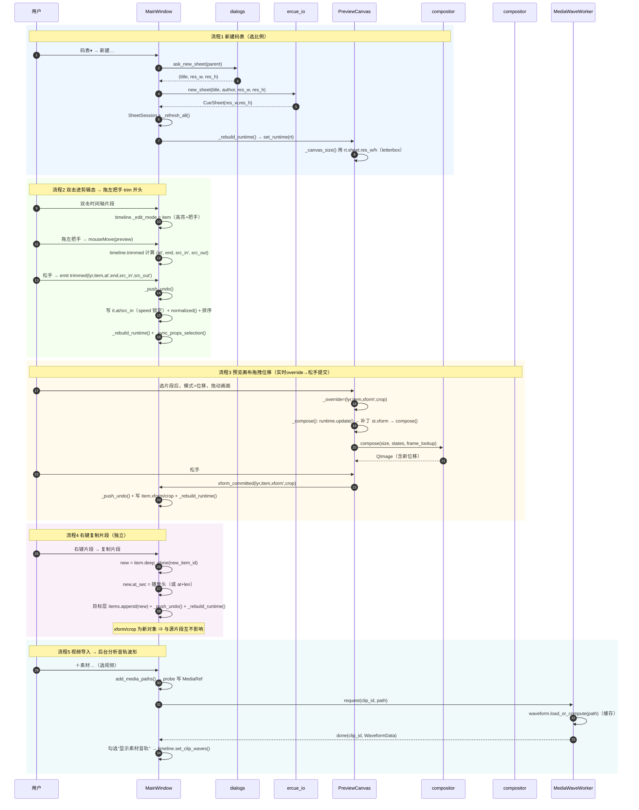
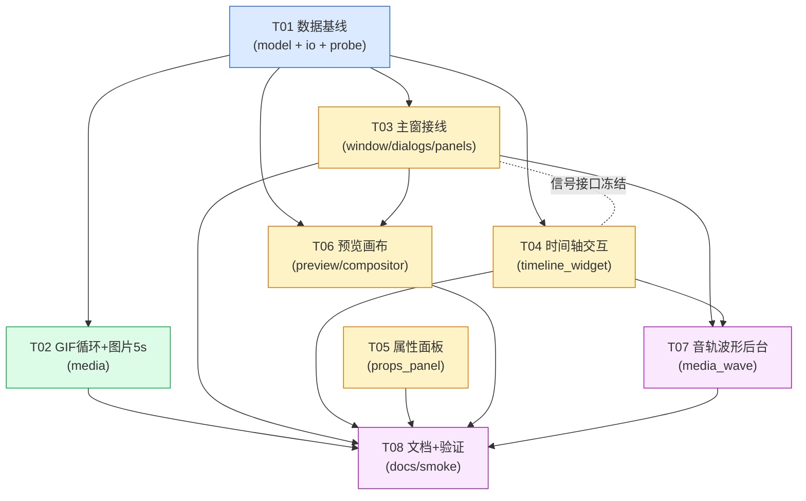

# EasyRealityCue —— 12 条需求：系统设计与任务分解

> 范围：**仅 ERCUE**（DJ 端码表编排工具）。AutoVJ（演出端 ERAVJ）同类问题**不在本次**，但其中
> 2 条需求（码表比例、GIF 循环）存在**跨端消费**，本文单独标出。
>
> 铁律（不可破，逐条对照落地）：
> 1. `model/`、`media/`、`audio/` **不准 import PySide6**（可脱离 Qt 跑自检）。
> 2. `.ercue` = zip + `cuesheet.json`，`FORMAT_VERSION=1`；**加"可选字段"不升版本**。
> 3. `timeline_widget.py` 的**波形绘制**逻辑（`_paint_waveform` / `_paint_ruler` / `wave_sample`）
>    **尽量别动**；交互层可改。
> 4. 模型内部**唯一坐标 = 秒**；拍只在 `ercue_io` 序列化边界出现一次。

---

## 零、结论先行（TL;DR）

| # | 需求 | 落点 | 是否动 `.ercue` | 是否跨端 |
|---|------|------|----------------|----------|
| 1 | 码表比例系统 | `CueSheet` + 新建弹窗 + 预览画布 | **加可选字段** `res_w/res_h`（不升版本） | ★ 演出端需读 |
| 2 | Delete 键删片段 | `window` 快捷键 + `del_cue` | 否 | 否 |
| 3 | 拖拽剪辑（双击 trim） | `timeline_widget` 交互 + `window` 落模型 | 否（复用现有字段） | 否 |
| 4 | 图片默认 5s / GIF 循环 | `probe` 常量 + `frames` 环绕 | 否 | ★ GIF 循环演出端需同步 |
| 5 | 去掉 ＋cue / 删除cue 按钮 | `window` 工具条 | 否（**无 cue 数据概念**，无迁移） | 否 |
| 6 | 右上角独立"导出"入口 | `window` 顶栏（**双入口**） | 否 | 否 |
| 7 | 变速滑动条 + 手动框 | `props_panel` | 否 | 否 |
| 8 | PR 式画布变换交互 | `preview` overlay + `window` 提交 | 否（写既有 `xform/crop`） | 否 |
| 9 | 改名"本素材混合" | `props_panel` + 文档 | 否 | 否 |
| 10 | 同素材多图层独立 | 判定：**数据层本已独立**（详见 §3.4）+ 加固 | 否 | 否 |
| 11 | 视频音轨波形 + 开关 | `frames/waveform` 复用 + `timeline` 绘制 + `window` 开关 | 否 | 否 |
| 12 | 时间轴右键菜单 | `timeline_widget` 信号 + `window` 菜单 | 否 | 否 |

**没有任何一条需求必须破坏 `.ercue` 兼容**。唯一"新增字段"（比例）走"可选字段"路线，旧码表/旧演出端
读不到即回落 16:9，不阻断。

---

# Part A：系统设计

## 1. 实现方案（逐条）

### 需求 1 —— 码表比例系统（进数据模型）

**目标**：默认 16:9；新建码表时弹窗选 16:9 / 9:16 / 4:3 / 3:4 / 自定义；比例影响预览画布宽高比、
几何适配基准、导出、演出端消费。

**改哪里**
- **数据模型**（`model/cuesheet.py`）：`CueSheet` 新增两个 int 字段
  `res_w: int = 1920`、`res_h: int = 1080`（**可选字段**，缺省即 16:9）。加入
  `to_state_dict()/from_state_dict()`（撤销栈与快照要带上）。
- **序列化**（`model/ercue_io.py`）：`sheet_to_file_dict()` 顶层加 `"res_w"/"res_h"`；
  `sheet_from_file_dict()` 用 `_i(d.get("res_w"), 1920)` 容错读取。`new_sheet()` 增加
  `res_w/res_h` 形参。
  ⚠ `compat_selftest._assert_file_struct_equal` 顶层只逐字段比 4 个键
  （`format_version/title/notes/min_app_version`）⇒ **新增顶层可选字段不会破坏兼容自检**
  （与 `file_md5` 同处理思路；若担心，可像 `file_md5` 一样"比对前 pop"）。
- **新建弹窗**（`ui/dialogs.py`）：新增 `ask_new_sheet(parent, default_title)`，返回
  `(title, res_w, res_h)` 或 `None`。界面：码表名输入框 + 比例下拉
  （16:9 / 9:16 / 4:3 / 3:4 / 自定义）+ 自定义时的 W/H 两个 `QSpinBox`（默认 1920×1080）。
- **接线**（`ui/window.py`）：`_pkg_menu` 的"新建…"与 `pkg_panel.newSheet` 都改走
  `_new_sheet_dialog()`；`new_sheet(title, res_w, res_h)` 写进 `CueSheet`。
- **预览画布**（`ui/preview.py`）：`_canvas_size()` / `paintEvent()` 里**写死的 `9/16`**
  改为读 `self.runtime.sheet` 的 `res_h/res_w`（拿不到用 9/16）。**letterbox 仍然居中**。
- **几何适配基准**：`render/compositor.py` 的 cover/contain 用**传入的 `size=(W,H)`** 作为
  基准 ⇒ 只要预览画布尺寸按比例来，cover/contain（`_target_src`）自动跟随，**无需改合成器**。

**与现有机制衔接**：本字段是"**画布/输出规格**"，不是几何变换，故与 `xform/crop` 正交。

**演出端消费（跨端）**：ERAVJ 需读 `res_w/res_h`，把"编排画布"按该比例 fit 到实际输出屏
（letterbox/cover）。若演出端忽略该字段 ⇒ 退回它自身比例（**不崩、不阻断**，但构图会不符）。
⇒ **必须与演出端同步一条约定**（见 §5 待明确 Q1）。

---

### 需求 2 —— Delete 键删片段

- 绑**在时间轴控件上**，不用窗口级快捷键：
  `QShortcut(QKeySequence(QKeySequence.Delete), self.timeline, context=Qt.WidgetWithChildrenShortcut, activated=self.del_cue)`。
  **理由**：窗口级 `Delete` 会在用户编辑 `QLineEdit`（备注）/`QDoubleSpinBox` 时**误删片段**
  （抢走文本框的删除键）；绑到 timeline + `WidgetWithChildrenShortcut` 只在时间轴聚焦时生效。
- 复用现有 `MainWindow.del_cue()`（`ui/window.py:1119`，已带 `_push_undo` + 选中清空 + 重建）。
- ⚠ 需求标题写"删**素材**"，描述是"选中**片段**→删除"。按描述实现 = 删**片段**（CueItem），
  不删 `MediaRef`（删素材已有：素材面板右键"从这张码表里去掉"）。见 §5 待明确 Q2。

---

### 需求 3 —— 拖拽剪辑（双击进入剪辑态 → trim 开头/末尾）

**交互设计（裁定）**
- **双击片段** ⇒ 该片段进入**剪辑态**（`_edit_mode` 指向它；视觉：高亮边框 + 左右两端各一个
  trim 把手）。同一时刻仅一个片段处于剪辑态。
- 剪辑态下：
  - 拖**左把手** ⇒ **trim 开头**
  - 拖**右把手** ⇒ **trim 末尾**
  - 拖**片段中部** ⇒ **整体平移**（保持时长，语义 = 现有 `_shift_item`）
- 退出剪辑态：单击空白 / Esc / 双击别的片段。
- **单击（非剪辑态）**：仅选中，不再立即进入拖动（避免误拖）。

**核心裁定：trim 改的是"源内起止 + 时间轴起止"两者（由 `speed` 锁定），不 ripple。**

理由：只改时间轴长度 ⇒ 画面内容与时间轴错位/被拉伸；只改源内起止 ⇒ 用户拖不动块。两者必须
同改。公式（`at/end` 秒，`src_in/src_out` 秒，`speed`，素材时长 `S`）：

- **trim 开头**：拖到新时间轴起点 `at'`（`Δ = at' - at`）
  - `src_in' = clamp(src_in + Δ * speed, 0, S')`
  - 若 `src_in'` 触 0（已到素材头）：`at' = at - src_in / speed`（不能再往左）
  - `end` 不变。收缩（Δ>0）= 掐掉开头；外拉（Δ<0）= 还原已掐掉的开头（受 `src_in≥0` 限制）。
- **trim 末尾**：拖到新时间轴终点 `end'`
  - `len' = max(0, end' - at)`；`src_out' = src_in + len' * speed`
  - 若 `src_out' > S`（素材不够长）：`src_out' = S`，`end' = at + (S - src_in) / speed`
    （**钳住，不产生"冻结尾帧"**；若 `S` 未知 ⇒ 保持 `end'`、`src_out'` 置 `None`）。
- 落模型后 `it.normalized()` 兜底（`end ≥ at`、`speed` 钳 0.1~3.0、`crop` 长度守卫）。

**改哪里**
- `ui/timeline_widget.py`（交互层）：
  - 新增 `self._edit_mode`（存剪辑态 item 或 None）、`self._trim`（拖动把手时的预览状态）。
  - 新增 `mouseDoubleClickEvent`（进/退剪辑态）、`keyPressEvent`（Esc 退出）、
    `contextMenuEvent`（见需求 12）。
  - `mousePressEvent`：仅当**剪辑态**且命中把手时进入 trim 拖动；否则保持"选中/平移"。
  - 新增信号 `trimmed = Signal(str, str, float, object, float, object)`
    → `(lyr_id, item_id, at_sec, end_sec|None, src_in_sec, src_out_sec|None)`。
    **模型的最终写入在 window**（单数据流，控件不直接改模型）。
  - 绘制：**只**在 `_paint_clip` 增加"剪辑态高亮 + 两个把手"的少量绘制；**`_paint_waveform`
    / `_paint_ruler` / `wave_sample` 一行不动**。
- `ui/window.py`：新增 `_on_timeline_trimmed()`（`_push_undo` → 写 `at/end/src_in/src_out`
  → `normalized()` → 排序 → `_rebuild_runtime()` → `_sync_props_selection()`）。

**与现有机制衔接**：现有 `resized` 信号（单按边缘改时长）**保留但不再直接暴露给用户**（边缘
拉边现在只在剪辑态触发），避免两套交互打架。`_on_timeline_moved`（平移）不动。

---

### 需求 4 —— 图片默认 5 秒 + GIF 循环

- **图片默认时长 5 秒**：`media/probe.py` 加模块常量 `IMAGE_DEFAULT_SEC = 5.0`（**唯一来源**，
  零 Qt）。`window._clip_duration_sec()`：当 `MediaRef.duration_sec<=0` 且该素材是图片
  （`probe.kind_of(path)=="image"`）时返回 `IMAGE_DEFAULT_SEC`。于是 `add_cue()` 会写出
  `end_sec = at + 5.0`（不再是 `None` 的"到下一段/曲终"）。
  - 顺带：`probe.probe()` 可对图片回填 `duration_sec = IMAGE_DEFAULT_SEC`（让"超长"预检也一致）。
- **GIF 循环**（**必须落在 `media/`，零 Qt**）：`media/frames.py`
  - `_Source.__slots__` 增 `is_looping` / `loop_dur`。
  - 打开容器时：`is_looping = (ext == ".gif")`；`loop_dur = 容器/流时长`（PyAV 对 GIF 可得一轮时长）。
  - `frame` / `frame_exact` / `frame_play` 取帧前：`if src.is_looping and src.loop_dur>0:
    sec = sec % src.loop_dur`（**环绕**，于是"素材到达出点冻结"（A2）对 GIF 不再发生）。
  - **运行时侧**：GIF 片段**不要**设 `src_out_sec`（保持 `None`），让 `play_sec` 一路增长、由
    `frames` 环绕 ⇒ 时间轴多长就循环多久。
- **跨端**：演出端 ERAVJ 需同样支持"GIF 环绕"（否则现场 GIF 只播一轮）。见 §5 待明确 Q3。

---

### 需求 5 —— 去掉时间轴上「＋cue / 删除cue」两个按钮

- **改哪里**：`ui/window.py`
  - `_build()`（L346-349）删除 `btn_add_cue` / `btn_del_cue`。
  - `_wire()`（L449-450）删除两条 `clicked` 连线。
  - `_refresh_buttons()`（L1828-1829）删除两个按钮的启用态设置。
- **保留但不再从按钮触达**：`_add_cue_at_playhead()`（素材**双击/拖拽**仍走它）、`del_cue()`
  （**Delete 键** + **右键菜单**仍走它）。→ "加片段"入口改为：素材面板双击 / 拖到时间轴层上。
- ⚠ **旧码表 cue 数据怎么处理**：本工具**没有独立的"cue"数据概念** —— "cue" 只是 UI 对
  `CueItem`（片段）的叫法。故：
  - **数据模型零变化**：`CueItem` 即"片段"，旧码表里的片段**原样保留**；
  - **无迁移、无字段废弃**：`snap` 字段本就为旧格式保留（吸附已移除），继续保留；
  - 仅**移除 UI 命名与按钮**，"cue"一词从工具条消失。
- **文档**：`使用说明.txt` 工具条描述同步（去掉两按钮，改为"Delete 删片段 / 右键菜单"）。

---

### 需求 6 —— 右上角新增独立"导出"入口

- **裁定：双入口**（新增，不移动）。理由：现有"码表▾ 菜单 → 导出…"与"① 码表包 → 导出…"
  已在用，移动会破坏既有习惯与面板一致性；顶栏加一个高可见度按钮成本极低、收益大。
- **改哪里**（`ui/window.py`）：顶栏（`_build` 顶栏 `top` 布局）右侧 `addStretch(1)` 之后加
  `self.btn_export = QPushButton("导出")`，`clicked → self._export_dialog`。放在最右（"右上角"）。
  `_refresh_buttons()` 里按"有 session 且 sheet 非空"置启用态。

---

### 需求 7 —— 变速改为拖动横轴 + 保留手动输入框（双向同步）

- **改哪里**：`ui/props_panel.py`
  - 在"变速"行加一个水平 `QSlider`（范围映射 `0.10~3.00 → 10~300`，即 ×100），与现有
    `sp_speed`（`QDoubleSpinBox`，0.1~3.0）**并排**。
  - **双向同步**：`sld_speed.valueChanged → sp_speed.setValue(v/100)`；
    `sp_speed.valueChanged → sld_speed.setValue(round(v*100))`。
  - **防自激**：两处写入都必须包在 `_loading` 守卫内（沿用 B2 纪律），`_on_edit` 在守卫期间
    直接 `return`（现有机制已具备）。
  - `refresh()` 回填时**同时**设 slider 与 spinbox；`commit()` 仍读 `sp_speed.value()`（不改）。
- 纯 UI，无模型/格式变化。

---

### 需求 8 —— PR 式画布变换交互（在预览上直接拖/拉做 crop / x,y / scale）

**底层已就绪**：`xform={scale,x,y}`、`crop=[x,y,w,h]` 已在模型 + `compositor` 实现。
**缺的是 UI 操作层**（`ui/preview.py`）。

**交互设计**
- 预览画布**上方/下方加一条小工具条**：`模式：位移 | 缩放 | 裁切`（互斥）+ `重置` 按钮。
  默认"位移"。仅在**选中了片段**时可交互（无选中 = 只读预览，行为不变）。
- **位移**：在画面内拖动 ⇒ `xform.x/y`（单位 = **画布百分比**，与 `props_panel` 的 `%` 一致）。
  `Δx_pct = Δpx / W * 100`。拖动即让该层从 cover 切到 contain（`_is_custom` 变真，符合预期）。
- **缩放**：拖**四角把手** ⇒ `xform.scale`（相对 1.0 的比例）。
- **裁切**：拖**裁切框的四边/四角** ⇒ `crop=[x,y,w,h]`（源归一化 0~1）。
- **实时反馈不重建运行时**：拖拽期间，`PreviewCanvas` 持有 `self._override =
  (lyr_id, item_id, xform, crop)`；`_compose()` 在 `runtime.update()` 后，对匹配的
  `LayerDrawState` **补丁** `st.xform/st.crop`，再合成 ⇒ 即时看到效果。
  **松手时**才发信号提交模型（`push_undo` + 写 + 重建）—— 避免每个 mouse move 都
  `set_runtime()`（会触发 `CueFrameSource.release(None)` 释放全部解码器，代价大）。
- **坐标映射**：位移/缩放用画布百分比/比例（简单）。**裁切把手**需要"预览像素 ↔ 源归一化"
  的逆映射，该映射依赖该层当前的 fit（cover/contain）与 crop 基准 ⇒ **复用
  `compositor._target_src(st, fw, fh, W, H)`** 取 `(tgt_rect, src_rect)` 反解，**不重复实现几何**。

**改哪里**
- `ui/preview.py`：`set_ratio(...)`（见需求 1）、工具条、`set_selection(lyr,item)`、
  把手命中/拖动、`_override` 补丁、信号 `xform_committed = Signal(str, str, dict, object)`。
- `ui/window.py`：`_on_preview_xform_committed()`（push_undo → 写 item → `_rebuild_runtime`
  → `_sync_props_selection`）。选中变化时把选中片段喂给 `preview.set_selection(...)`。
- `render/compositor.py`：**仅在需要**时暴露一个只读辅助（若 `_target_src` 已够用则**不改**）。

---

### 需求 9 —— 改名"本层混合" → "本素材混合"

**所有出现处（已全量搜出，`i18n` 层不存在 —— 本项目无 i18n 模块，UI 文案全是内联中文字面量）**
| 文件 | 行 | 内容 | 处理 |
|------|----|------|------|
| `src/ercue/ui/props_panel.py` | 164 | `add("本层混合", self.cb_blend)` | 改 `"本素材混合"` |
| `src/ercue/ui/props_panel.py` | 168 | `add("本层不透明度", self.sp_op)` | ⚠ 见下 |
| `使用说明.txt` | 49/51 | "…本层混合…" | 改文案 |
| `dist_wave/EasyRealityCue/使用说明.txt` | 49/51 | 旧打包副本 | 随打包更新，非源码 |
| `docs/码表功能设计_v0.2.md` | 132 | "本层下一个片段" | **不同语境**（非该标签），不动 |

- **字段名**：不存在叫"本层混合"的字段；实际字段是 `CompLayer.blend`（**层级**），
  **无需改字段名**，也不动 `.ercue`。
- ⚠ **语义冲突（必须指出）**：`blend`/`opacity` 是**层（CompLayer）属性**，且"没选中片段时
  编辑的是当前层"。把标签改成"本**素材**混合"会让"层属性"叫成"素材属性"，**语义不符**。
  - **方案 A（照需求做）**：仅改字面量为"本素材混合"。建议**同时**改"本层不透明度"为
    "本素材不透明度"以保持成对一致（否则一栏内"本素材/本层"混用更乱）。
  - **方案 B（如需真·按素材）**：把混合/不透明度下沉为 **`CueItem` 级**属性（新增可选字段
    `item.blend`/`item.opacity`，层级作 fallback），合成器按 item 取 blend。这是**二期**，
    改动大（`timeline` 输出 `LayerDrawState.blend` 目前来自层）。见 §5 待明确 Q4。

---

### 需求 10 —— 同素材多图层独立（**根因判定**）

> 详见 §3.4「数据结构与接口」的判定与加固。

**结论：数据层"本已独立"，既不是"引用共享"，也不需要"深拷贝"补丁。**
证据（静态逐路径核对）：
- 每次"拖素材到层"走 `timeline.clip_dropped → window._on_clip_dropped → add_cue()`
  （`window.py:1065`），`add_cue` **每次 `CueItem(...)` 全新构造**，`item_id` 由
  `_next_num` 全局递增 ⇒ **两个片段是两个独立对象**。
- `CueItem.xform` 用 `field(default_factory=lambda: {...})`（**每实例独立 dict**）；
  `crop` 默认 `None`；`CompLayer.items` 用 `field(default_factory=list)`。**无可变默认共享**。
- 所有"派生/快照"路径都已显式拷贝：`to_state_dict`（`dict(xform)` / `list(crop)`）、
  `timeline` 输出 `LayerDrawState.xform = dict(it.xform)`、`ercue_io` 往返重建对象。

**用户看到的"共享"最可能是**（按可能性排序）：
1. **渲染层解码器/帧共用**（`preview._build_lane_map` 以 `(clip_id, round(play_sec,3))` 为键，
   同素材、**同一时刻**的叠层落到**同一 lane**、同一帧）⇒ 两层画面**看起来一样**，但
   **片段设置各自独立**。这是 by-design（同位置叠层本属同一条播放线）。
2. **把 `MediaRef`（时长/alpha，按 `clip_id` 共享）误当成片段设置**。
3. 在**旧构建版本**上的历史现象。

**加固（无论根因是哪条都做）**
- `model/cuesheet.py` 新增 `CueItem.deep_clone(new_item_id="") -> CueItem`：**显式复制**
  `xform`（新 dict）、`crop`（新 list）、`items` 无（item 无子项）⇒ 供"右键复制"等派生路径
  **统一**使用，杜绝未来浅拷贝。
- 新增单测 `tests/test_item_independence.py`：同素材拖两层 ⇒ 两 item 的 `id(xform)` 不同、
  改其一的 `xform/crop/src_in/speed` 不影响其二；`deep_clone` 后同样独立。
- （可选）若用户**确实**要"同素材同刻叠层也各自独立取帧"：把 `_build_lane_map` 的键改为
  含 `lyr_id`（`(clip_id, round(play_sec,3), lyr_id)`）⇒ 各层各持解码器。**代价**：解码器数
  上升（受 `POOL_MAX_*` 上限约束，超限退化为共用）。见 §5 待明确 Q5。

---

### 需求 11 —— 视频导入顺带分析音轨波形 + 时间轴下方开关

**目标**：导入**视频素材**时，顺带分析其**音轨波形**（便于与歌曲音频轨对齐）；时间轴下方加
一个**开关**控制是否显示素材音轨波形。

**改哪里**
- **分析**（复用现成、零 Qt）：`audio/waveform.py` 的 `load_or_compute(path)` 对视频文件同样可用
  （`_decode_mono16k` 取 `streams` 中第一个 `audio` 流）。**无需改算法**；缓存键已含
  `path|mtime|size|版本|列数`。
- **后台 worker（新增文件）**：`src/ercue/ui/media_wave.py` 新增 `MediaWaveWorker(QThread)`
  （**队列式**，非 latest-wins —— 多个素材都要算）。`request(clip_id, path)` /
  `done(clip_id, WaveformData|None)` / `stop()`。照 `panels.ThumbWorker` 套路。
- **接线**（`ui/window.py`）：`add_media_paths()` 里对**视频**素材登记播放器分析请求；结果
  落地到 session 级缓存（`{clip_id: WaveformData}`，可挂 `SheetSession`），再喂给时间轴。
- **开关**（`ui/window.py`）：时间轴**下方**加 `QCheckBox("显示素材音轨")`（默认关）→
  `timeline.set_show_clip_audio(bool)`。
- **绘制**（`ui/timeline_widget.py`，**新增**而非改旧）：
  - `self._show_clip_audio`、`self._clip_wav = {clip_id: WaveformData}`（由 window 喂入）。
  - 新增 `_paint_clip_audio(p, ly, it, rect)`：在片段块内绘制该素材音轨波形
    —— 像素 ↔ 列按"片段可见窗口"映射：`x ∈ [at,end]` 对应源 `[src_in, src_out]`（`speed` 换算），
    列号 = 源秒 × `COLUMNS_PER_SEC`。**只画可见列**。
  - **`_paint_waveform`（歌曲轨）与 `_paint_ruler` 一行不动。**

**与现有机制衔接**：歌曲波形（音频轨）与素材波形（片段内）**互相独立**；开关只管后者。

---

### 需求 12 —— 时间轴片段右键菜单

**最小集（裁定）**：`属性` / `复制片段` / `重置画面变换` / `删除片段` / `定位素材`。

| 菜单项 | 动作 | 备注 |
|--------|------|------|
| 属性 | 切到"④ 片段属性"标签页并聚焦 | 现有 `_sync_props_selection` |
| 复制片段 | 在**播放头**（或原 `at+len`）创建**同素材同设置的新片段** | **必须 `deep_clone`**（需求 10 加固）；新全局 `item_id` |
| 重置画面变换 | `crop=None`，`xform=默认` | 便于需求 8 回退 |
| 删除片段 | `del_cue()` | 与 Delete 键同一实现 |
| 定位素材 | `_reveal_media(clip_id)` | 复用现有 |

**改哪里**
- `ui/timeline_widget.py`：新增 `contextMenuEvent` → 命中片段则 `set_selected` 并
  `emit context_menu(lyr_id, item_id, global_pos)`；命中空白则不弹（或弹"粘贴"二期）。
- `ui/window.py`：新增 `_on_timeline_menu(lyr_id, item_id, pos)` 构建 `QMenu`
  （**菜单在 window 构建**，符合"控件只发信号、窗口落模型"），动作调 window 方法。

---

## 2. 文件清单

### 修改
```
src/ercue/model/cuesheet.py        # CueSheet.res_w/res_h（可选字段）；CueItem.deep_clone()
src/ercue/model/ercue_io.py        # sheet_to/from_file_dict 顶层 res_w/res_h；new_sheet 参数
src/ercue/media/probe.py           # IMAGE_DEFAULT_SEC；is_gif()；图片 duration 回填
src/ercue/media/frames.py          # GIF 循环（is_looping/loop_dur + sec 环绕）
src/ercue/ui/dialogs.py            # ask_new_sheet()（新建码表 + 比例）
src/ercue/ui/window.py             # 新建弹窗/比例、顶栏导出按钮、去 cue 按钮、Delete 键、
                                   # 右键菜单动作、图片 5s、preview 变换提交、音轨波形开关与接线
src/ercue/ui/timeline_widget.py    # 双击剪辑态 + trim、右键信号、素材音轨绘制、把手/高亮绘制
src/ercue/ui/props_panel.py        # 变速滑动条 + 手动框双向同步；"本素材混合"改名
src/ercue/ui/preview.py            # 按比例出画面；PR 式变换 overlay；xform_committed 信号
src/ercue/render/compositor.py     # （仅在需求 8 需要时）暴露只读几何辅助；否则不动
src/ercue/audio/waveform.py        # （如需要）视频音轨复用的小 helper；算法不动
使用说明.txt                        # 工具条/操作说明/改名 同步
```

### 新增
```
src/ercue/ui/media_wave.py         # MediaWaveWorker：后台给多个素材算音轨波形（队列式）
tests/test_model_ratio.py          # 比例字段：往返 + 旧码表（无字段）回落 16:9 + 兼容
tests/test_item_independence.py    # 需求 10：多图层片段相互独立 + deep_clone 独立
tests/test_timeline_trim.py        # 需求 3：trim 公式（开头/末尾、speed、钳位）
docs/需求_12条_设计.md              # 本文
docs/class-diagram.mermaid         # 类图（本文 §3 导出）
docs/sequence-diagram.mermaid      # 时序图（本文 §4 导出）
```

> 说明：`tests/test_timeline.py` / `tests/test_ui_smoke.py` 因新增信号/接口需要**增量更新**
> （补断言，不改既有断言口径）。

---

## 3. 数据结构与接口

### 3.1 类图（Mermaid classDiagram）

```mermaid
classDiagram
    class CueSheet {
        +str title
        +str author
        +int format_version
        +int res_w          %% ★新增（可选字段，默认1920）
        +int res_h          %% ★新增（可选字段，默认1080）
        +list~MediaRef~ media
        +list~TrackEntry~ tracks
        +aspect() (float,float)   %% ★新增便捷：返回归一化宽高
        +media_by_id(clip_id) MediaRef
        +match_track(...) (TrackEntry, str)
        +to_state_dict() dict
        +from_state_dict(d) CueSheet
    }
    class TrackEntry {
        +str track_key
        +Identity identity
        +Composition composition
    }
    class Identity {
        +str fp_id
        +str file_md5
        +str meta_id
        +str title
        +str artist
        +float duration_sec
        +float bpm
        +str file_name
    }
    class Composition {
        +list~CompLayer~ layers
        +sorted_layers() list
    }
    class CompLayer {
        +str lyr_id
        +str name
        +int z
        +str blend           %% 层级混合（需求9仅改UI文案，不改此字段）
        +float opacity
        +list~CueItem~ items
    }
    class CueItem {
        +str item_id
        +str clip_id
        +float at_sec
        +float end_sec        %% None=到本层下一片段/曲终
        +float src_in_sec
        +float src_out_sec    %% None=到素材末尾
        +float speed
        +list~float~ crop     %% [x,y,w,h] 归一化；None=不裁
        +dict xform           %% {scale,x,y,rot}
        +str trans_in
        +float trans_in_sec
        +str trans_out
        +float trans_out_sec
        +str snap             %% 旧格式兼容保留
        +str note
        +deep_clone(new_item_id) CueItem  %% ★新增：显式深拷贝(xform/crop)
        +normalized() CueItem
    }
    class MediaRef {
        +str clip_id
        +str name
        +str sha256
        +bool embedded
        +float duration_sec
        +bool has_alpha
    }
    class CueRuntime {
        +int bpm
        +list~LayerDrawState~ update(pos_sec)
    }
    class LayerDrawState {
        +str lyr_id
        +int z
        +str blend
        +float opacity
        +str clip_id
        +float play_sec
        +list~float~ crop
        +dict xform
        +float speed
        +float alpha
    }
    class CueTimeline {
        +Signal picked
        +Signal moved
        +Signal resized
        +Signal trimmed         %% ★新增
        +Signal context_menu    %% ★新增
        +bool _show_clip_audio  %% ★新增
        +set_show_clip_audio(on)
        +set_clip_waves(dict)
    }
    class PreviewCanvas {
        +set_ratio(res_w,res_h)                 %% ★新增
        +set_selection(lyr,item)                %% ★新增
        +Signal xform_committed                 %% ★新增
        +_override                              %% 拖拽期间补丁
    }
    class MediaWaveWorker {
        +request(clip_id, path)
        +Signal done
        +stop()
    }

    CueSheet "1" o-- "*" MediaRef
    CueSheet "1" o-- "*" TrackEntry
    TrackEntry "1" *-- "1" Identity
    TrackEntry "1" *-- "1" Composition
    Composition "1" o-- "*" CompLayer
    CompLayer "1" o-- "*" CueItem
    CueItem ..> MediaRef : clip_id
    CueRuntime ..> CueSheet : 读 res/media
    CueRuntime ..> LayerDrawState : 产出
    CueTimeline ..> LayerDrawState : 不直接依赖
    MediaWaveWorker ..> MediaRef : 按 clip_id 产波形
    PreviewCanvas ..> CueRuntime : update()
```

### 3.2 新增字段一览（**全部可选，不升版本**）

| 结构 | 字段 | 类型 | 默认 | 文件形态键 | 说明 |
|------|------|------|------|-----------|------|
| `CueSheet` | `res_w` | int | 1920 | `res_w`（顶层，可选） | 码表画布宽 |
| `CueSheet` | `res_h` | int | 1080 | `res_h`（顶层，可选） | 码表画布高 |

> 除上表外，**其余 11 条需求不新增任何 `.ercue` 字段**：需求 3/8/12 只**写既有** `at/end/
> src_in/src_out/speed/crop/xform`；需求 5/6/7/9/10/11 为 UI/行为层；需求 4 的 5s 与 GIF 循环
> 是**行为**（不落盘）。

### 3.3 接口签名（关键）

```python
# model/cuesheet.py
@dataclass
class CueSheet:
    res_w: int = 1920          # ★新增
    res_h: int = 1080          # ★新增
    def aspect(self) -> tuple: # ★新增：返回 (res_w, res_h)，非法回落 (1920,1080)
        ...

@dataclass
class CueItem:
    def deep_clone(self, new_item_id: str = "") -> "CueItem":
        """显式复制一个全新片段：xform 新 dict、crop 新 list、其余字段逐一同值。
        供‘右键复制’等派生路径统一使用，杜绝浅拷贝被共享。"""

# model/ercue_io.py
def new_sheet(title="新建码表", author="", res_w=1920, res_h=1080) -> CueSheet: ...
# sheet_to_file_dict: 顶层加 "res_w": int(sheet.res_w), "res_h": int(sheet.res_h)
# sheet_from_file_dict: res_w=_i(d.get("res_w"),1920); res_h=_i(d.get("res_h"),1080)

# media/probe.py
IMAGE_DEFAULT_SEC = 5.0                     # ★唯一来源
def is_gif(path) -> bool: ...               # ★按扩展名

# media/frames.py  （gif 环绕，零 Qt）
# _Source 增: is_looping, loop_dur
# frame/frame_exact/frame_play: 取帧前 sec = sec % loop_dur（仅 gif）

# ui/dialogs.py
def ask_new_sheet(parent, default_title="新建码表"):
    """返回 (title, res_w, res_h) | None"""

# ui/timeline_widget.py
class CueTimeline(QWidget):
    trimmed       = Signal(str, str, float, object, float, object)  # lyr,item,at,end|None,src_in,src_out|None
    context_menu  = Signal(str, str, object)                        # lyr,item,globalPos
    def mouseDoubleClickEvent(self, e): ...
    def contextMenuEvent(self, e): ...
    def keyPressEvent(self, e): ...                # Esc 退剪辑态
    def set_show_clip_audio(self, on: bool): ...
    def set_clip_waves(self, waves: dict): ...     # {clip_id: WaveformData}

# ui/preview.py
class PreviewCanvas(QWidget):
    xform_committed = Signal(str, str, dict, object)  # lyr,item,xform,crop
    def set_ratio(self, res_w, res_h): ...
    def set_selection(self, lyr_id, item_id): ...
    def set_override(self, lyr_id, item_id, xform, crop): ...  # 拖拽期间补丁

# ui/media_wave.py（新增）
class MediaWaveWorker(QThread):
    done = Signal(str, object)                     # clip_id, WaveformData|None
    def request(self, clip_id, path): ...
    def stop(self): ...
```

### 3.4 需求 10 —— 根因判定与"数据结构层如何保证独立"

**判定**：当前创建路径（`add_cue`）**每次全新构造 `CueItem`**，`xform`/`crop` 均为 per-instance
（`default_factory`），快照/运行时均已显式拷贝 ⇒ **数据层不存在引用共享，也不缺深拷贝**。
用户观察的"共享"最可能是**渲染层的 lane/帧共用**（`(clip_id, play_sec)` 为键）或把 `MediaRef`
误当片段设置。

**数据结构层保证独立的机制（已存在 + 加固）**：
1. `CueItem.xform`：`field(default_factory=lambda: {...})` ⇒ 每实例独立 dict。
2. `CueItem.crop` 默认 `None`；赋值走**新 list**（`props_panel.commit` / `from_state_dict` 均新建）。
3. `CompLayer.items`：`field(default_factory=list)`。
4. 往返/快照**全显式拷贝**：`to_state_dict`（`dict`/`list`）、`from_state_dict`（重建对象）、
   `timeline` 的 `LayerDrawState.xform = dict(it.xform)`。
5. **加固**：`CueItem.deep_clone()` 作为**唯一**"派生片段"入口；配套单测钉死独立性。

**若用户要"渲染层也各自独立取帧"**：把 `preview._build_lane_map` 的键由 `(clip_id, play_sec)`
改为 `(clip_id, play_sec, lyr_id)`（或 lane 直接用 `lyr_id`）—— 见 §5 Q5（**代价**：解码器数上升，
受 `POOL_MAX_PER_PATH/TOTAL` 上限约束）。

---

## 4. 程序调用流程（Mermaid sequenceDiagram）



---

# Part B：任务分解

## 5. 所需第三方包（无新增）

```
PySide6-Essentials==6.11.2   # GUI（QtCore/QtGui/QtWidgets）—— 已用
av==18.1.0                   # PyAV 解码（含 GIF 循环、视频音轨提取）—— 已用
numpy==2.5.3                 # 波形/合成数值 —— 已用
mutagen==1.48.1              # 音频标签/时长 —— 已用
sounddevice==0.5.6           # 音频走带 —— 已用
```
**本 12 条需求不引入任何新第三方依赖**（GIF 循环用 PyAV、波形复用现有 DSP、比例/变换为纯逻辑）。

---

## 6. 任务列表（有序、含依赖；4 个批次）

> 约束自检：
> · **批次 1 是"基础设施"**（数据模型 + 序列化 + 常量），全部后续任务的公共前置。
> · **`ui/window.py` 由 T03 单一持有**，避免并行写冲突；T06（preview）通过**冻结的信号接口**
>   与 T03 对接。
> · 每任务 ≥3 个相关文件（或"1 源文件 + 对应测试 + 文档"）。
> · 无长链依赖：绝大多数任务仅依赖 T01。

### 批次 1 —— 数据基线（串行，先做）
| ID | 任务 | 源文件 | 依赖 | 优先级 |
|----|------|--------|------|--------|
| **T01** | **数据层**：比例字段进模型与序列化 + `deep_clone` + 图片默认秒常量 + GIF 判定 | `model/cuesheet.py`、`model/ercue_io.py`、`media/probe.py`、`tests/test_model_ratio.py`(新)、`tests/test_item_independence.py`(新) | 无 | **P0** |

**T01 交付物**：`CueSheet.res_w/res_h`（可选字段，缺省 1920×1080）+ `aspect()`；
`CueItem.deep_clone()`；`IMAGE_DEFAULT_SEC=5.0`；`probe.is_gif()`；`new_sheet(res_w,res_h)`；
**往返自检** + **旧码表（无 `res_w/res_h`）回落 16:9** 断言 + **独立性强断言**。
> 该任务不改任何 Qt；`python -m ercue.model.cuesheet` / `ercue_io` / `probe` 自检必须全绿。

### 批次 2 —— 媒体解码层（可并行于批次 3）
| ID | 任务 | 源文件 | 依赖 | 优先级 |
|----|------|--------|------|--------|
| **T02** | **GIF 循环 + 图片 5s 媒体侧**：`frames` 环绕、`probe` 回填图片时长 | `media/frames.py`、`media/probe.py`、`tests/test_media.py` | T01 | **P0** |

**T02 交付物**：GIF `sec` 环绕（零 Qt，`_Source` 增 `is_looping/loop_dur`）；图片探测量出
`IMAGE_DEFAULT_SEC`。`python -m ercue.media.frames` 自检绿。

### 批次 3 —— 界面层（window 单写；timeline/props/preview 各自文件，可并行）
| ID | 任务 | 源文件 | 依赖 | 优先级 |
|----|------|--------|------|--------|
| **T03** | **主窗接线（唯一改 window.py）**：新建弹窗+比例、顶栏导出按钮、去掉 cue 两按钮、Delete 键、右键菜单动作、图片 5s 接入、preview 变换提交 handler、素材音轨开关与接线 | `ui/window.py`、`ui/dialogs.py`、`ui/panels.py` | T01 | **P0** |
| **T04** | **时间轴控件**：双击剪辑态 + trim（新信号）、右键菜单信号、素材音轨绘制、把手/高亮绘制 | `ui/timeline_widget.py`、`tests/test_timeline.py`、`tests/test_timeline_trim.py`(新) | T01（接口与本表冻结） | **P0** |
| **T05** | **片段属性**：变速滑条 + 手动框双向同步；"本素材混合"改名 | `ui/props_panel.py`、`tests/test_ui_smoke.py` | 无（可并行） | **P1** |
| **T06** | **预览画布**：按比例出画面（letterbox）+ PR 式直接拖/拉做 crop/位移/缩放（overlay + 提交） | `ui/preview.py`、`render/compositor.py`（如需只读辅助）、`tests/test_compositor.py` | T01、T03（提交 handler） | **P1** |

**接口冻结（T03↔T04↔T06 必读）**——见 §3.3 的 `trimmed` / `context_menu` / `xform_committed`
签名与 `set_show_clip_audio` / `set_selection` / `set_ratio` 方法名。

### 批次 4 —— 音轨波形接线 + 文档 + 验证
| ID | 任务 | 源文件 | 依赖 | 优先级 |
|----|------|--------|------|--------|
| **T07** | **音轨波形后台化**：`MediaWaveWorker` + window 登记/缓存接线（需求 11 前半） | `ui/media_wave.py`(新)、`ui/window.py`、`audio/waveform.py`（如需 helper） | T03、T04 | **P1** |
| **T08** | **文档 + 全量验证**：使用说明/设计文档/`i18n`（无）同步；全量自检 + UI 冒烟 + 打包 | `使用说明.txt`、`docs/架构方案.md`、`docs/需求_12条_设计.md`、`tools/smoke_exe.py`、`tests/*` | T02~T07 | **P1** |

---

## 7. 任务依赖图（Mermaid）



- **T02 / T05 可完全并行**（不依赖 T01 之外的任何任务；T05 甚至无依赖）。
- **T03 / T04 可并行开发**，但**接口必须先冻结**（本文 §3.3）—— T04 产生信号、T03 消费。
- **T06 依赖 T03**（提交 handler 在 window）。
- **T07 依赖 T03+T04**；**T08 收尾**（最后做）。

---

## 8. 风险与待明确

### 8.1 互相影响 / 依赖关系的条目
- **R1（需求 1 ↔ 需求 8）**：预览画布比例改了，需求 8 的"预览像素 ↔ 画布/源"映射必须**同时**
  改用新比例与新 `W,H`。两者都在 `preview.py`，**建议同一人（T06）实现**，避免映射不一致。
- **R2（需求 1 ↔ 合成器 cover/contain）**：比例只改"画布尺寸"，cover/contain 基准随之变；
  若演出端输出屏比例 ≠ 码表比例，需 fit 策略（letterbox vs cover）。**跨端约定**（Q1）。
- **R3（需求 3 ↔ 需求 8）**：都改"边界/几何"，但一个是时间轴 trim（`timeline_widget`），一个是
  画面变换（`preview`），互不重叠。注意 **undo 语义**：两者都必须 `_push_undo`（拖拽期间只
  本地预览、松手一次入栈），否则撤销栈会被每帧塞满。
- **R4（需求 4 ↔ 需求 1/3）**：图片 5s 影响 `end_sec`；GIF 环绕与"到出点冻结"（A2）**冲突**，
  故 GIF 片段**必须不设 `src_out`**（§需求 4）。实现时务必按素材类型分支。
- **R5（需求 5 ↔ 需求 2 ↔ 需求 12）**：cue 按钮去掉后，"加/删片段"必须**已**由
  ［素材双击/拖拽］+［Delete 键］+［右键菜单］覆盖，**顺序上 T03/T04 要一起做**，否则中间态
  "删不掉片段"。
- **R6（需求 10 ↔ 需求 12 的"复制"）**：复制片段**必须**走 `deep_clone`；若实现成浅引用，
  会**亲手制造**用户抱怨的"共享"。单测 `test_item_independence` 钉死。
- **R7（需求 11 ↔ 老波形绘制）**：素材音轨绘制是**新增**方法（`_paint_clip_audio`），
  **不得**触碰 `_paint_waveform`（歌曲轨）；否则违反"绘制逻辑尽量别动"。
- **R8（性能）**：需求 11 的后台分析（多视频）与需求 8 的拖拽重合成都可能抢 CPU；两者都
  **不得**在 GUI 线程做重活（波形在 worker 线程；变换用 `_override` 免重建）。

### 8.2 建议拆到二期的条目
- **需求 8 的"裁切把手"**（需逆映射）—— 建议一期先做**位移/缩放**（坐标简单、收益最大），
  裁切把手二期（或一期做但充分单测）。
- **需求 11 的"片段内素材波形绘制"** —— 建议一期先做"后台分析 + 开关 + 简化绘制（幅度轮廓）"，
  精细化（三频段配色、src_in/out 精确对齐）二期。
- **需求 9 的方案 B（混合/不透明度下沉到 item 级）** —— 明显是**二期**（改合成器取 blend 来源）。

### 8.3 待明确（UNCLEAR / Q）
- **Q1（跨端·需求 1）**：`res_w/res_h` 的语义是"**编排设计画布**"还是"**最终输出分辨率**"？
  演出端拿到"设计画布比例 ≠ 输出屏比例"时按 **letterbox（留黑边）** 还是 **cover（裁切铺满）**？
  两端必须**同一约定**。
- **Q2（需求 2）**：Delete 删的是**片段**（本文按此）还是**素材**？（"删素材"另有入口。）
- **Q3（跨端·需求 4）**：演出端 ERAVJ 是否会**同步支持 GIF 循环**？若不同步，现场 GIF 只播一轮
  （编辑端循环、现场不循环 = 预览与现场不符）。
- **Q4（需求 9）**：是**只改字面量**（方案 A）还是**要把"混合/不透明度"变成按素材（item 级）**
  （方案 B）？"本层不透明度"是否一并改名？
- **Q5（需求 10）**：用户要的"独立"是**片段设置独立**（现状已满足）还是**渲染也各自独立取帧**
  （需改 `_build_lane_map` 键含 `lyr_id`，代价 = 解码器数上升）？**需一次实测复现**确认根因。
- **Q6（需求 6）**：顶栏"导出"是**双入口**（本文按此）还是**从左侧面板移除**？
- **Q7（需求 3）**：trim 是否**允许外拉还原**（把已 trim 掉的头/尾拉回来）？本文按"允许，受
  素材边界限制"设计；若只允许收缩需调整把手逻辑。
- **Q8（需求 11）**：素材音轨波形是否需要**三频段配色**，还是**单色幅度**即可（影响性能与实现量）？
  "开关"是只控制**素材轨**还是也控制**歌曲轨**（本文按只控素材轨）？
- **Q9（需求 1 自定义比例）**：自定义是**自由宽高**还是要**钳到常见值/上下限**（如 16~4096）？
  预览 letterbox 的最小可见高度阈值？

---

## 9. 共享知识（跨文件约定）

**新增字段命名**
- 一律 `snake_case`；单位后缀 `_sec`（秒）、比例/百分比用 `_pct` 或无单位（`xform.x/y` 为**画布
  百分比**，`crop`/`res_*` 为**归一化 0~1 / 整数像素**）。
- **新增 `.ercue` 字段一律"可选"**：`from_*` 用 `.get(key, 默认)` 容错，**不升 `FORMAT_VERSION`**。
- 比例字段固定名：顶层 `res_w` / `res_h`（int）。**不要**改成 `aspect`/`ratio` 字符串 —— 分辨率
  比 16:9 更能表达自定义值。

**UI 文案规范**
- 中文；成对概念用词一致（若采纳需求 9 方案 A，则"本素材混合/本素材不透明度"成对）。
- 本项目**无 i18n 层**（无 `tr()`/翻译文件），文案为**内联中文字面量**；改名 = 全局字面量替换。
- 时间轴"cue"一词**从 UI 移除**（需求 5）；文档同步。

**单位纪律（不可破）**
- 模型内部**只有秒**；`xform.x/y` 用**画布百分比**、`crop` 用**源归一化**、`res_*` 用**像素**。
- 拍↔秒只经 `units.py`，只发生在 `ercue_io` 序列化边界。**新增代码不得出现 `beat_len` 乘除**。

**数据流 / 纪律（沿用既有 B1~B6、A1~A7、D2~D4、E1~E4）**
- **单向数据流**：控件只 `emit` 信号，**主窗口统一落模型**（`timeline`/`preview`/`props` 均如此）。
- **每个改动操作必须 `_push_undo()` 一次**（拖拽期间只本地预览，**松手一次入栈**）。
- **`model/`、`media/`、`audio/` 零 Qt**：GIF 循环（`frames`）、图片默认秒（`probe`）、图片/视频
  波形（`waveform`）都**不得** import PySide6；由 `ui/` 侧的后台线程调用。
- **`timeline_widget.py` 波形/标尺绘制不动**（`_paint_waveform`/`_paint_ruler`/`wave_sample`）。

**测试要求**
- `model/`、`media/`、`audio/` 改动 ⇒ **模块自检必须绿**（`python -m ercue.model.cuesheet` /
  `ercue.model.ercue_io` / `ercue.media.frames` / `ercue.media.probe` …）。
- 新增必测：
  - `test_model_ratio.py`：比例往返 + **旧码表（无字段）回落 16:9**；
  - `test_item_independence.py`：多图层片段独立 + `deep_clone` 独立（需求 10）；
  - `test_timeline_trim.py`：trim 公式（开头/末尾、含 `speed`、含边界钳位）（需求 3）。
- **兼容红线**：任何改动后 `ercue_io.compat_selftest()` / `state_vs_file_selftest()` 必须仍绿
  （钉死"文件形态含拍、状态快照不含拍"与新旧双向兼容）。
- UI 冒烟：`tests/test_ui_smoke.py`（无头 `QT_QPA_PLATFORM=offscreen`）增量断言新按钮/快捷
  键/信号存在；**不引入交互式阻塞**（`_interactive=False` 路径不变）。

---

## 10. 附：需求 → 任务 → 文件 对照

| 需求 | 任务 | 主要文件 |
|------|------|----------|
| 1 比例系统 | T01, T03, T06 | cuesheet / ercue_io / dialogs / window / preview |
| 2 Delete 删片段 | T03 | window |
| 3 拖拽剪辑 trim | T04, T03 | timeline_widget / window |
| 4 图片 5s / GIF 循环 | T01, T02, T03 | probe / frames / window |
| 5 去 cue 按钮 | T03 | window |
| 6 右上导出入口 | T03 | window |
| 7 变速滑条 | T05 | props_panel |
| 8 PR 画布变换 | T06, T03 | preview / compositor / window |
| 9 改名"本素材混合" | T05, T08 | props_panel / 使用说明.txt |
| 10 多图层独立 | T01（加固+判定） | cuesheet / tests |
| 11 音轨波形 + 开关 | T07, T04, T03 | media_wave / waveform / timeline_widget / window |
| 12 右键菜单 | T04, T03 | timeline_widget / window |
