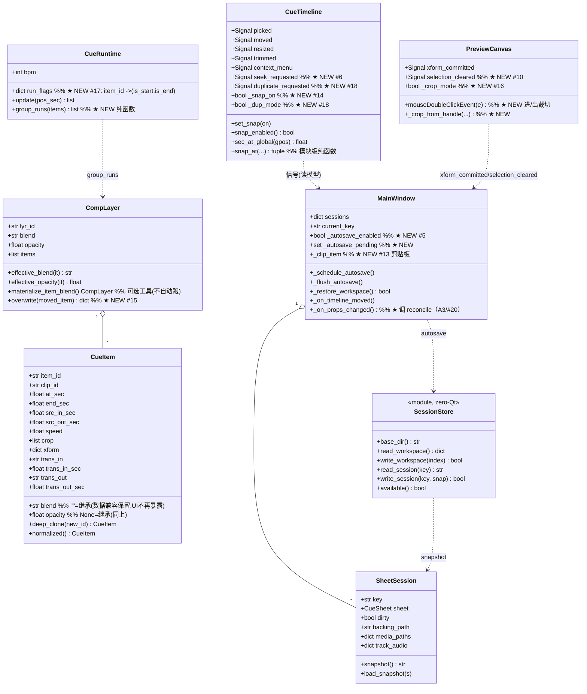
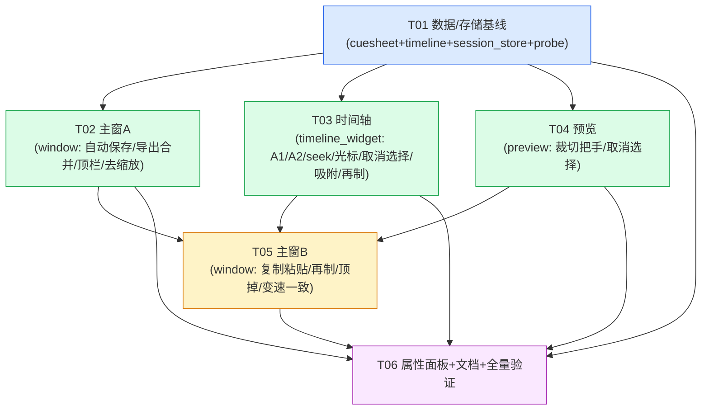

# EasyRealityCue —— 24 条新需求：系统设计与任务分解

> 范围：**仅 DJ 端 EasyRealityCue**（码表编排工具）。产出评审格式对照 `docs/需求_12条_设计.md`。
>
> **架构铁律（不可破，逐条自检）**
> 1. `model/`、`media/`、`audio/` **不准 import PySide6**（可脱离 Qt 跑自检）。
> 2. `.ercue` = zip + `cuesheet.json`，`FORMAT_VERSION=1`；**加"可选字段"不升版本**。
> 3. `timeline_widget.py` 的**波形/标尺绘制**逻辑（`_paint_waveform` / `_paint_ruler` / `wave_sample`）
>    **一行不动**；交互层可改。
> 4. 模型内部**唯一坐标 = 秒**；拍只在 `ercue_io` 序列化边界出现一次。
> 5. **`ui/window.py` 同批次只能由一个任务独占**（上一轮踩过：并行改 window 必冲突）。
>
> **承前**：12 条需求已全部落地（`docs/需求_12条_落地对照.md`）。本轮 24 条中，**#12 推翻**上一轮
> 需求 9 的"继承本层"交互（仅交互层，数据兼容见 §3.2）；**#16 是上一轮留二期的"裁切把手"，本轮做**。

---

## 零、结论先行（TL;DR）

| # | 需求 | 类型 | 落点（主） | 是否动 `.ercue` | 与现有机制冲突？ |
|---|------|------|-----------|----------------|------------------|
| A1 | 双击裁剪时时间轴全消失 | **Bug** | `timeline_widget._paint_clip` | 否 | 否 |
| A2 | 拖视频素材时其音轨波形不跟手 | **Bug** | `timeline_widget._paint_clip_audio` | 否 | 否 |
| A3 | 变速后时长错 | **Bug** | `model/cuesheet` + `window._on_props_changed` | 否 | ⚠ 与现有"时长/入出点自由"口径需收敛（§1.A3） |
| A4 | 新建弹窗/右键 NameError（已修） | 记录 | — | 否 | 否 |
| B5 | 所有操作及时保存（自动保存） | **大功能** | 新 `model/session_store` + `window` | 否（**不碰 .ercue**） | ⚠ 与"未保存三选保护"需重定义（§3.1） |
| C6 | 时间刻度点击 ⇒ 播放头移过去 | 交互 | `timeline_widget` + `window` | 否 | 否 |
| C7 | 去掉放大/缩小两按钮 | 交互 | `window._build/_wire/_refresh_buttons` | 否 | 否 |
| C8 | 导出改「导出当前码表」+ 显眼 | 交互 | `window` | 否 | ⚠ 与"另存为"去留联动（§1.C8） |
| C9 | 双击裁剪时鼠标换左右箭头 | 交互 | `timeline_widget` | 否 | 否 |
| C10 | 点空白取消选择（预览 + 时间轴） | 交互 | `timeline_widget` + `preview` + `window` | 否 | 否 |
| C11 | 预览标签后显示当前码表名 | 交互 | `window` | 否 | 否 |
| C12 | 去掉两处「继承本层」 | 交互 + **兼容** | `props_panel`（数据兼容见 §3.2） | 否（**数据零迁移**） | ⚠ **推翻**上轮需求 9 交互 |
| D13 | 右键「复制 / 粘贴」（全属性） | 中功能 | `window`（+`timeline_widget` 空处右键） | 否 | 否 |
| D14 | 「自动吸附」开关（只动被拖的） | 中功能 | `timeline_widget`（纯函数）+ `window` | 否 | 否 |
| D15 | 同层叠加改 PR「顶掉」 | **较难** | `model/cuesheet.CompLayer.overwrite` + `window` | 否 | ⚠ **冲突**"同层允许叠放"（§1.D15） |
| D16 | PS 式裁切把手（二期→本轮做） | 中功能 | `preview`（+`media/probe.video_size`） | 否 | 否 |
| E17 | 相邻同设置视为一个素材（淡入淡出只一遍） | **较难** | `model/timeline`（纯逻辑） | 否 | ⚠ 渲染语义变更（§3.4） |
| E18 | CDR 式「再制」 | **较难** | `timeline_widget`（状态机）+ `window` | 否 | ⚠ 与右键菜单抢右键（§3.5） |
| E19 | 新建码表命名输入框 | **无需新做** | 已有 `dialogs.ask_new_sheet` | 否 | 否 |
| F20 | 变速一致性（与 A3 同源） | **合并到 A3** | — | 否 | — |

**没有任何一条需求必须破坏 `.ercue` 兼容。** 全 24 条**不新增 `.ercue` 字段、不升版本**（#12 只删交互、
#17 只改渲染判定、#5 存到独立 session 目录而非 `.ercue`）。

> **★ 全部 8 个待明确项（Q1–Q8）已裁定**（用户拍板 Q2/Q3/Q5；lead 定 Q1/Q4/Q6/Q7/Q8）——
> 结论与"受影响处"见 **§8.4**；正文相关条目已标 `【Q#.已裁定】`。

---

# Part A：系统设计

## 1. 实现方案（逐条）

### A 组：三个 Bug（**先复现，再修**）

> A 组纪律：每条**先给出可复现脚本/命令**（能稳定看到症状），**再给修法**。修完必须回跑复现脚本「由红转绿」。

---

#### A1 —— 双击裁剪时，时间轴上所有东西消失（松手才回来）

**复现（先做）**
`tools/_t24_a1_verify.py`（真窗口 `QApplication` + `timeline.grab()`）：
1. 建 1 层 1 片段；`tl.set_view(0, 40)`；`tl.grab()` 存 `before`。
2. 双击片段进剪辑态（`tl.mouseDoubleClickEvent(...)` 或直接 `tl._edit_mode = it`）。
3. **在把手处按下**（`tl.mousePressEvent(...)`，命中左边缘 `edge=="l"`）——**此时不移动鼠标**。
4. `tl.grab()` 存 `after`；断言「`after` 中片段像素带消失 / 抛出 `TypeError`」。
5. 调用 `tl.mouseReleaseEvent(...)`，再次 `grab()`，断言画面恢复（`before≈restored`）。

**根因（已定位，行号精确定位）**
`timeline_widget.py` `mousePressEvent`（L1124-1134）进入 trim 拖动时把 `_trim` 初始化成
`{"preview": None, ...}`；而 `_paint_clip`（L861-867）：

```python
if self._trim is not None and self._trim.get("item") is it:
    pa, pe = self._trim.get("preview", (at, end))[:2]     # ← "preview" 键存在且值为 None
```

`.get("preview", (at, end))` 由于 **键存在、值是 `None`**，返回 `None`（不是默认元组）⇒ `None[:2]`
抛 `TypeError` ⇒ `paintEvent` 中断 ⇒ 本帧只画了标尺、**所有片段不画**（"全消失"）；松手时
`mouseReleaseEvent` 把 `_trim=None` ⇒ 下一帧恢复正常（"松手才回来"）。

> 为什么无头测试没抓到：既有 `test_timeline_trim.py` 只测「移动后 emit」，**没测"按下但未移动"这一帧的绘制"**
> ⇒ 正是"无头不执行/未覆盖的分支"（见 §9 新约定）。

**修法（最小改动，交互层）**
`_paint_clip` 里把 `preview` 为 `None` 的情况显式兜底：

```python
if self._trim is not None and self._trim.get("item") is it:
    pv = self._trim.get("preview")
    if pv is not None:
        pa, pe = pv[:2]
    else:
        pa, pe = at, end            # 按下但未移动：用当前几何，绝不解引用 None
    if pe is None:
        pe = end
    x0 = self._x(pa); x1 = self._x(max(pe, pa + 0.5))
```

**顺带加固**（同源隐患）：`mousePressEvent` 里建 `_trim` 时把 `"preview"` 初值设为 `(at0, end0)`
（而非 `None`），双保险；`_resize` 分支已是 `.get("preview", (at,end))` 且键不存在 ⇒ 安全，**不动**。

---

#### A2 —— 拖动视频素材时，其音频波形不跟手（要等松手才移过去）

**复现（先做）**
`tools/_t24_a2_verify.py`（真窗口）：
1. 真视频素材 + 1 片段；开「显示素材音轨」并喂入真波形（`tl.set_clip_waves({clip_id: wf})`）。
2. `tl.grab()` 存 `before`。
3. 程序化「按下-拖动 80px」：`mousePressEvent` 落在片段中部（进入 `_drag`）→ 设
   `_last_mx` 右移 80px → `mouseMoveEvent`（`_preview_dx≈+80`）→ `tl.grab()` 存 `after`。
4. 断言：`after` 中**片段块整体右移 80px**，但**波形包络的水平包围盒没跟着移**（仍在原像素列）
   ⇒ 复现"不跟手"。松手（`mouseReleaseEvent`）后再 `grab()`，波形才到位。

**根因（行号）**
`_paint_clip`（L854-872）把 rect 按 `_preview_dx` 平移；但 `_paint_clip_audio`（L932-973）内部用
**模型里的旧 `it.at_sec`** 做「像素→源秒」映射：

```python
at = _units.to_float(it.at_sec)          # ← 拖动中未变（模型松手才改）
src_sec = src_in + max(0.0, self._sec(x) - at) * spd
```

⇒ rect 移动了、但波形采样仍按"旧起点"算 ⇒ **波形图案锚在原屏幕位置**（视觉上"不跟手"）。
`_trim` / `_resize` 拖动时 rect 用 `preview` 平移，也有同样问题（一并修）。

**修法**
`_paint_clip` 计算"本次绘制用的有效起点秒 `at_draw`"（含 `_drag/_resize/_trim` 的 preview 平移），
把它**作为参数传给** `_paint_clip_audio(p, ly, it, rect, at_draw)`；`_paint_clip_audio` 用 `at_draw`
替代 `it.at_sec`。`at_draw` 由像素偏移换算：
`at_draw = it.at_sec + (x0_draw - self._x(it.at_sec)) / px_per_sec`，等价地直接取
`at_draw = self._sec(物理左边缘)`。**`_paint_waveform` / `wave_sample` 一行不动**（歌曲轨独立）。

---

#### A3 / #20 —— 变速后时长错（合并设计："变速一致性"）

**复现（先做）**
`tools/_t24_a3_verify.py`（真窗口，无头即可）：
1. 加 10 秒视频素材；在播放头加片段 ⇒ `end = at + 10`。
2. 选中片段，`props_panel.sp_speed.setValue(0.5)` ⇒ commit。观察 `it.speed==0.5`，**`it.end_sec` 未变**。
3. 把「时长」拉到 20（`sp_len`）⇒ `it.end_sec = at+20`，`it.src_out` 仍未设。
4. 把 `sp_speed` 调回 `1.0` ⇒ **`it.end_sec` 仍 = at+20**（复现"时间轴仍显示 20s"）；
   跑到 `pos=at+15` 看 `CueRuntime` 的 `play_sec≈15 > 素材 10s` ⇒ 合成器钳到末帧
   ⇒ "实际只播前面 10s"。

**根因**
`props_panel.commit()`（L429）只写 `it.speed`，**从不重算 `end_sec` / `src_out_sec`**；`window._on_props_changed`
也不做一致性收敛 ⇒ `speed`、`end_sec`、`src_out_sec` 三者可互相矛盾。真源缺失：**`end_sec - at_sec`
与 `(src_out - src_in)/speed` 没有任何地方保证相等**。

**修法（把"唯一自洽关系"下沉到 model，纯逻辑）**
新增（`model/cuesheet.py`，零 Qt）：

```python
def item_source_used_sec(it, src_dur=0.0):
    """本片段用到的源长度：src_out 已知 → src_out - src_in；
       否则 src_dur>0 → src_dur - src_in；否则 None（未知，无法收敛）。"""

def reconcile_item_timing(it, prev, src_dur=0.0) -> str:
    """让 at/end/src_in/src_out/speed **自洽**（"唯一权威关系"：
         end - at  ==  (src_out_eff - src_in) / speed     （src_out 未知则用 src_dur）。
       按"用户到底改了哪个"决定派生物（prev = 改动前的 at/end/src_in/src_out/speed）：
         · speed 变（源范围未变）      → **源范围权威**：end = at + used/speed
         · src_in/src_out 变（时长未变）→ **源范围权威**：end = at + used/speed
         · 时长(end) 变（源范围未变）   → **时长权威**：src_out = src_in + (end-at)*speed（钳到 src_dur）
         · 都变 / 无法判定              → 源范围优先（end 派生）
         · src_out 未知且 src_dur 未知  → 不动（记一条日志），保持现状
       返回做了什么：'end_from_source' / 'src_from_end' / 'none'。"""
```

接线（`window._on_props_changed`）：`_push_undo()` 前先抓 `prev = {at,end,src_in,src_out,speed}`，
`p.commit()` 后调 `reconcile_item_timing(it, prev, src_dur=self._clip_source_dur(it.clip_id))`
（新增私有 helper：**视频/音频取 `MediaRef.duration_sec`（有新探测回填）；图片/未知 → 0**）。
`_clip_source_dur` 与 `_clip_duration_sec` 的区别：前者是"素材**全长**"，图片返回 0（图片无源长度，
不参与收敛）。

**边界 / 与现有机制衔接**
- **"末尾定格"（hold last frame）保持可用**：用户**显式改「时长」**时走"时长权威"支 ⇒ `end` 保留，
  只把 `src_out` 钳到 `src_dur`（= 定格），**不会被自动缩短**。
- **GIF（不设 `src_out`）**：`item_source_used_sec` 对 GIF 返回 `src_dur - src_in`（一轮时长）；
  speed 改变会重算 `end`（循环片段也符合直觉）。**GIF 仍绝不写 `src_out`**（沿用需求 4 兜底）。
- **图片（`src_dur=0`）**：`used=None` ⇒ 不收敛（图片"时长"本就用户自定义，speed 对其无意义）。
- `add_cue` 已经是"speed=1.0 且 end=at+全长"（自洽），不必改。
- trim（`compute_trim`）已自洽，不必改；但 trim 之后 `reconcile` 也不会误伤（源范围与 end 已一致）。

> **裁定**：把"自洽关系"放 model（可离线测）、把"按哪个字段变了"的判定放 `window`（它知道面板语义）。
> 这样 `model` 保持纯逻辑，`window` 保持独占。
>
> **【Q7.已裁定】触发面 = 单点**：`reconcile` **只在 `props_panel.commit()` 之后**被调用一次
> （`window._on_props_changed`）；**不在入点/出点处单独再调**（commit 已覆盖；"改了哪个字段"由
> `prev` 快照统一判定）。⇒ 避免多处调用引入循环/重入。**"用户显式改时长 ⇒ 定格"认可**。

---

### B 组

#### B5 —— 自动保存（大功能，重点设计）

**用户诉求**："不管我加几个素材/码表/音频，下次打开还在"。

**核心裁定（三条）**
1. **存哪 = 独立 session 目录，绝不写用户的 `.ercue`。**
   - 理由：`.ercue` 是**交付物**（给演出端）。若每次编辑都静默改写它，用户无法区分"我发布的版本"与"草稿"
     （且内嵌素材被反复重打包，体积/风险巨大）。把 WIP 存到独立目录，**崩溃/关窗都不丢**，而 `.ercue`
     只在用户显式"导出"时写。
   - 位置：`%LOCALAPPDATA%\EasyRealityCue\autosave\`（与 `config.json` 同父目录；**可用环境变量
     `ERCUE_AUTOSAVE_DIR` 覆盖**，供测试/工具隔离）。
   - **文件形态 = session 状态快照（秒坐标 JSON）**，复用现有 `SheetSession.snapshot()`（已含
     `sheet + ti + track_audio + media_paths`）。**不**用 `.ercue` 文件形态（不需要拍、不需要内嵌媒体），
     也避免再写一套格式。
2. **何时存 = 事件驱动 + 防抖 + 关键点强制 flush。**
   - 任何一个会改模型的入口（**都经过 `_mark_dirty()`**）⇒ 追加 `_schedule_autosave()`：
     把当前 session key 放进 `self._autosave_pending`，**重启单发定时器** `AUTOSAVE_DEBOUNCE_MS=1500`。
   - 定时器到点 ⇒ `_flush_autosave()`：把 `_autosave_pending` 里每个 key **原子写**到
     `autosave/sheet_<key>.json`，再原子写 `autosave/workspace.json`（索引）。
   - **关键点强制 flush（不等防抖）**：切换码表（`_switch_to`）、新建/导入/关闭码表、切曲目、
     应用关闭（`closeEvent`→`shutdown`）、**导出前**。
   - **安全网**：`AUTOSAVE_SAFETY_MS=30000` 周期定时器，只要 `_autosave_pending` 非空就 flush
     （防"防抖定时器被某种原因吃掉"）。
   - 开销：快照是坐标级 JSON（KB 级，**不含媒体**）⇒ 每 1.5s 写一次可忽略。
3. **多码表怎么管 = 一个 workspace 索引 + 每码表一个快照文件。**
   - `workspace.json`：`{version, app_version, saved_at, current_key, key_seq, sessions:[{key,title,
     backing_path,dir,export_dirty,ti,file}]}`。
   - `sheet_<key>.json`：该 session 的 `snapshot()` JSON（**权威状态**）。
   - 启动恢复：读 `workspace.json` → 逐 session 读快照 → `SheetSession` 重建 → 还原 `current_key`、
     `ti`、`media_paths`、`track_audio`、`backing_path`、`key_seq`（`_key_seq = max(key_seq, 已用最大)`）。
   - **崩溃恢复**：因为**持续自动保存**，"崩溃后恢复"= 恢复最近一次 autosave，**无需额外机制**。
     仅在启动恢复时**记一条日志 + 状态行提示**："已恢复上次退出时的 N 张码表（草稿）"。
   - **隔离（重要）**：新增构造参数 `MainWindow(restore_workspace=True, autosave=True)`，
     并读取环境变量 `ERCUE_NO_AUTOSAVE=1` 关闭。测试/工具用 `MainWindow(restore_workspace=False,
     autosave=False)` 或设环境变量，**绝不让测试污染真实 workspace**。

**与"未保存三选保护"（save/discard/cancel）的关系（重定义）**
- **"丢失工作"的三选保护不再需要**：WIP 有 autosave 兜底 ⇒ 关窗不会丢"编排本身"。
- **保留一条"未导出提醒"**（因为 `.ercue` 交付物仍只在显式导出时写）：
  - 复用 `sess.dirty`，语义重定义为「**自上次导出为 `.ercue` 以来有改动**」；下拉框文案
    "（未保存）" → **"（未导出）"**。
  - `closeEvent`：**先静默 flush autosave**；若有 session `dirty` ⇒ 弹**软提示**
    （"有 N 张码表还没导出为 `.ercue`。草稿已自动保存，下次打开会恢复。要现在导出吗？"），
    **默认按钮 = 「跳过并退出」**（不再阻断、不再有"取消"导致关不掉）。可用配置
    `prompt_export_on_close`（默认 `True`）关闭。
  - `_confirm_discard` 的 `"cancel"` 分支保留（用户主动点取消才不关）。
  - **【Q5.已裁定】规则定死**：**有改动未导出 ⇒ 弹非阻断提示**（默认按钮「跳过并退出」，想导出可取消）；
    **无改动 ⇒ 静默退出**（不弹任何框）；提示本身可用 config `prompt_export_on_close`（默认 `True`）关掉。

**导出 / 另存为合并（用户已拍板："去掉另存为，保留顶栏导出当前码表"）**
- **删除**：`码表▾ → 另存为…`、`pkg_panel.saveAs` 入口、`_save_as_dialog`、`_wire` 里 `saveAs` 连线、
  `pkg_panel` 面板上的"另存"按钮（`ui/panels.py`）。
- **保留并改名**：顶栏按钮 `btn_export` 文案 → **「导出当前码表」**（见 C8 显眼化）。
- **语义**：`_export_dialog`（已存在）就是唯一"写 `.ercue`"入口：
  - `backing_path` 有 ⇒ 文件对话框默认到它（用户可直接回车覆盖，或改名另存）；
  - `backing_path` 无 ⇒ 默认 `<dir>/<title>.ercue`；
  - 写成功 ⇒ 置 `backing_path`、`dirty=False`、进最近文件。
- `_save_session`（关窗/`_confirm_discard` 用的）保留，作为"软提示里选了导出"时的落地实现
  （无 `backing_path` 时仍弹保存框）。**行为与 `export_sheet` 统一**（内部调 `export_sheet`）。

**数据结构（workspace 索引）**
```jsonc
{
  "version": 1,
  "app_version": "2026.10.16.07",
  "saved_at": "2026-10-16T20:10:00+0800",
  "current_key": "sheet3",
  "key_seq": 3,
  "sessions": [
    { "key": "sheet1", "title": "开场", "backing_path": "P:/x/open.ercue",
      "dir": "P:/media", "export_dirty": true, "ti": 0, "file": "sheet_sheet1.json" }
  ]
}
```

**明文风险**：autosave 目录不可写 ⇒ 优雅降级为"内存态"（照 `config.py` 的做法：吞异常、记日志、
`available()=False`），**绝不阻断编辑**。

---

### C 组：交互改进

#### C6 —— 时间轴时间刻度点击 ⇒ 播放指针移过去

**改哪里**：`timeline_widget` + `window`。
- `CueTimeline` 新增信号 `seek_requested = Signal(float)`（秒）。
- `mousePressEvent`：**在平移判定之前**插入 —— 若 `e.button()==Left && pos.y() < theme.RULER_H`
  ⇒ `seek_requested.emit(max(0.0, self._sec(pos.x())))`，`e.accept()`，**不进入平移**
  （现在点标尺会误触发平移）。
- **【Q6.已裁定】点击 = 定位（发 `seek_requested`）；拖动 = 平移（保持现状）**。
  **不做"拖动 scrub"** ⇒ 标尺只接"按下即 seek"，**不设** `_ruler_scrub` 连续发（避免与平移手势冲突）。
- `window`：`self.timeline.seek_requested.connect(lambda s: self._set_pos(s))`（走唯一位置入口 `_set_pos`）。

#### C7 —— 去掉时间轴左边的「放大 / 缩小」两按钮

**改哪里**：`window.py` 三处 + 文档 + 验证脚本。
- `_build`（L351-356）：删除 `btn_zoom_in` / `btn_zoom_out` 及其 `clicked.connect(...)`。
- `_wire`：无对应连线（连线在 `_build` 里，随删）。
- `_refresh_buttons`（L2169-2170）：删除两行启用态。
- 保留 `_zoom(k)` 方法（滚轮/将来可复用）或一并删；**推荐保留**（无副作用）。
- ⚠ **必须同步改**：`使用说明.txt`（工具条描述）、`tools/_t03_verify.py`（断言 `toolbar_buttons`
  列表）、`tools/_walk_ui_audit.py`（step00 记录）—— 否则验证脚本会红。
- 滚轮 / Ctrl+滚轮缩放在 `wheelEvent` 里**已有**，无需新增。

#### C8 —— 右上角导出改文案「导出当前码表」+ UI 更显眼

**改哪里**：`window._build`（`btn_export`）。
- 文案 `"导出"` → **`"导出当前码表"`**；tooltip 更新（说明它是唯一导出入口 + 与"另存为"合并）。
- **显眼化**：加 `objectName`/`setStyleSheet`（用 `theme` 强调色做底色/加粗/加大高度，
  例如 `background: theme.accent; color:#fff; font-weight:bold; padding:4px 12px;`），
  `setMinimumHeight(30)`。放在 `addStretch(1)` **之后最右**（已经是）。
- 与 B5 的"另存为合并"联动（同批：删 `_save_as_dialog`）。
- `_refresh_buttons`（L2166）：`btn_export.setEnabled(s is not None and self._sheet() is not None)` 不变。

#### C9 —— 双击裁剪时鼠标样式换成左右箭头

**改哪里**：`timeline_widget`（交互层）。
- `mouseMoveEvent` **无拖动时**：做一次 `_hit`；若 `self._edit_mode is not None and edge in ("l","r")`
  ⇒ `self.setCursor(Qt.SizeHorCursor)`；否则 `setCursor(Qt.ArrowCursor)`。
- 进入 trim 拖动（`mousePressEvent` 命中把手）也设 `Qt.SizeHorCursor`；
  `mouseReleaseEvent` 复位。
- ⚠ 不能破坏已有平移光标逻辑（平移用 `ClosedHandCursor`，其 `mouseReleaseEvent` 已复位 `ArrowCursor`）。

#### C10 —— 点空白处取消选择（**码表预览 + 时间轴 都要**）

**时间轴**（`timeline_widget`）：
- `mousePressEvent`：
  - 左键点在**标尺** ⇒ C6 的 seek（见上），不取消选择。
  - 左键点在**片段空白区/层外/音频行**（`hit[1] is None`，或 `hit row==-1`）⇒
    `self.sel=("",""); self.picked.emit("","")`，再照旧进入平移。
- 已有 `picked("","")` 分支保留（命中层但未命中片段时）。
- `window._select("","")` 已经会 `set_selected("","")` + `_sync_props_selection()`（清面板 + 清预览选中）。

**预览**（`preview.py`）：
- 新增信号 `selection_cleared = Signal()`。
- `mousePressEvent`：若「**已有选中** 且 点击落在**比例框之外**」或「比例框内但**不在图像**上」
  ⇒ `selection_cleared.emit()`（纯点空 = 取消）。框内点到图像（有选中）仍进位移拖动（不取消）。
- `window`：`self.preview.selection_cleared.connect(self._clear_selection)`，
  `_clear_selection()` = `self.timeline.set_selected("","")` + `_sync_props_selection()`。

> 交互一致性：两处"点空白"都收敛到 window 的 `_sync_props_selection()`（单一数据流）。

#### C11 —— 「码表预览」标签后显示当前码表名

**改哪里**：`window.py`。
- `_build`：把局部变量 `t_prev` 变成员 `self.lbl_preview_title`；文案改为
  `"码表预览 · <当前码表名>"`（空名回落"新建码表"）。
- 新增 `_refresh_preview_label()`，在 `_refresh_all()` 里调用（换码表/改名/新建都能刷新）。
- 当前码表名取 `self._sheet().title`。

#### C12 —— 去掉两处「继承本层」（**推翻上轮需求 9 的交互**）

**用户原话**："让一个一个设置"。故 **UI 不再提供"继承本层"**：
- 删除 `cb_blend` 的第 0 项「（继承本层）」（去掉 `INHERIT_LABEL` 条目）。
- 删除 `chk_op_inherit` 勾选框（`OP_INHERIT_LABEL`）与 `_on_op_inherit_toggled` /
  `_set_blend_inherit_enabled`（均无用了）。
- `refresh()`：选中片段时，混合下拉显示 `it.blend or layer.effective_blend(it)`，
  不透明度显示 `it.opacity`（None → `layer.effective_opacity(it)`）×100。
- `commit()`：照旧写 `it.blend = combo data`、`it.opacity = 值/100`。

**⚠ 数据兼容（旧码表 `item.blend=""` / `item.opacity is None` = 继承）——【Q4.已裁定】= "读时回落 + 首次编辑写显式"**
- **model 字段与惰性继承逻辑一行不改**：`item.blend=""` / `item.opacity=None` 仍表示"沿用本层"，
  `CompLayer.effective_blend/effective_opacity` 仍是唯一真源。**旧码表导入后行为逐值不变**。
- **UI 只"显示有效值、不再提供继承选项"**：因为显示的就是 effective 值，所以"首次编辑该片段任一字段"时
  `commit()` 把 effective 值**写成了该片段的显式值** ⇒ 等于"**首次编辑时自动物化**"，**值不变、行为不变**。
- **不改写整档**：用户若从不编辑某片段，其数据保持 `""`/None（导出时也照原样，不无端膨胀文件）。
- **不提供自动全量迁移**：保留 `CompLayer.materialize_item_blend()` 作为**可选工具**（文档注明），
  但**不在加载时自动跑**（避免"打开旧档就悄悄改写它"）。
- **导出兼容**：显式值经 `ercue_io` 写为可选键 `blend`/`opacity`；旧演出端忽略 `item.blend`、读层级
  `layer.blend` 不变 ⇒ **不破坏演出端**。

> 备选（不推荐）：在 `sheet_from_file_dict` 里对每层 `materialize_item_blend()`（硬迁移）。缺点：
> "打开旧档即改写用户数据"，与上一轮"零改写"承诺冲突，且对未编辑的档也产生 diff。
> **采用"读时回落 + 首次编辑物化"。**

---

### D 组：中等功能

#### D13 —— 右键菜单加「复制 / 粘贴」（复制含全部属性）

**复制**：`window` 维护 `self._clip_item`（存 `CueItem.deep_clone()`，**全部属性**：clip_id/位置/大小
/at/end/src_in/out/speed/crop/xform/淡入淡出/blend/opacity/note）。用 `deep_clone` 保证独立（需求 10）。
**粘贴落点裁定**：**鼠标位置优先**（右键时的秒），无右键上下文（快捷键）时用**播放头**。
落点层 = 右键所在的层（空处则当前层）。

**改哪里**：
- `timeline_widget`：`contextMenuEvent` 现在"空白不发"。改为 **空白也发**（`item_id=""`），供粘贴：
  - `context_menu = Signal(str, str, object)` **签名不变**（`lyr, item|"", globalPos`）。
  - 新增公有 `sec_at_global(global_pos) -> float`（把全局坐标换算成秒，供 window 定粘贴落点，
    避免 window 摸 `_sec` 私有方法）。命中空白时 `lyr` 取光标下的层（或 `""`）。
  - ⚠ `tests/test_timeline_trim.py` 的"空白不弹"断言要改为"空白也发（item=''）"。
- `window`：
  - `_on_timeline_menu`：`item_id==""` 时构建**仅含「粘贴」**的菜单（`enabled = 剪贴板非空`）。
  - `_build_item_menu` 增加 `"复制"` / `"粘贴"`（在"属性"之后）。
  - `_copy_to_clipboard(lyr,item)`：`self._clip_item = it.deep_clone()`。
  - `_paste_at(global_pos, lyr_id)`：`deep_clone(new_id)` → `at = sec_at_global(global_pos)`（回落
    `self._pos`）→ 加到目标层 → `_push_undo` → 重建。**粘贴 = 一次入栈**。
  - 可选快捷键 `Ctrl+C` / `Ctrl+V`（绑在 timeline，`WidgetWithChildrenShortcut`）。
- 保留上轮「复制片段」（就地/播放头快速复制）不动 —— 两者用途不同；菜单顺序见 §3.3。

#### D14 —— 「自动吸附」开关（**只移动正在拖的那个**）

**UI**：底部开关行 `clipbar` 里，`chk_clip_audio` **旁边**加 `QCheckBox("自动吸附")`（默认
**关**，读/写 `config["snap"]`）。⇒ `timeline.set_snap(on)`。

**逻辑**（`timeline_widget`，纯函数 + 拖动层调用）：
- 模块级纯函数：
  ```python
  def snap_at(at, dur, targets, px_per_sec, tol_px=SNAP_TOL_PX):
      """把"被拖片段"的**左端或右端**吸到最近的 target（片段 at/end、播放头、0）。
         返回 (at', snapped_target_sec|None)。targets 已排序。
         阈值 = tol_px / px_per_sec（像素阈值换算成秒）。"""
  ```
- `mouseMoveEvent` 的 `_drag` 分支：算出 `target`（新 at）后，若 `self._snap_on` ⇒ 用
  `snap_at(target, dur, self._snap_targets(), px_per_sec)` 修正；记录 `self._snap_guide`（画一条竖向导引线）。
- `_snap_targets()` = 当前轨道**所有层**的其它片段的 `at_sec` 与 `_item_end_px_sec`（含播放头、0）。
- **只移动被拖的那个**：吸附只改 `_preview_dx`/发出的 `at_sec`，**绝不写其它片段**（满足需求）。
- `_trim`/`_resize`：**可选**同步吸附（留 Q14a；默认只做移动）。
- `_paint_clip` 里画 `_snap_guide` 竖线（视觉反馈，可选）。

#### D15 —— 同层叠加改 PR 逻辑：A 挪到 B 的位置 ⇒ **顶掉 B**

**⚠ 与现有"同层允许叠放"的语义冲突（必须点明）**
- 现状：同层片段允许重叠（`CueRuntime._pick_item` 取"最后一个 at ≤ pos"的，重叠=后面的盖前面）。
  `#15` 要求改成"**覆盖式**"（拖 A 到 B 处 ⇒ B 被顶掉）。
- **裁定**：**仅在"拖动/落点进入某层"时**执行覆盖（move 与跨层 drop），**其余路径（`add_cue`/粘贴/复制片段）
  默认保持叠加**（降低爆炸半径；见 Q15）。**历史重叠数据不回溯处理**（只在下次移动时收敛）。

**判定规则（纯逻辑，`model/cuesheet.CompLayer.overwrite`）**
- 被放入片段 `A` 的有效区间 = `[A.at, A.end_eff]`（`end_eff`：`end_sec` 或"本层下一个片段起点/
  A.at+极小"，与 `_item_end_px_sec` 同口径）。
- 对同层每个其它片段 `B`（重叠判定用各自的 `end_eff`）：
  - **B 完全被 A 覆盖** ⇒ **删除 B**。
  - **A 只盖住 B 的左半**（`A.end` 落在 B 内部）⇒ **B 头部被裁**：`B.at = A.end`（`B.end` 不变）。
  - **A 只盖住 B 的右半**（`A.at` 落在 B 内部）⇒ **B 尾部被裁**：`B.end = A.at`。
  - **A 落在 B 内部**（B 全包 A）⇒ **B 被 A 顶掉**（按用户原话"把 B 那一段顶掉"：删除 B；
    不拆成两段，避免"凭空多出一段"）。
  - **恰好在边界相接（缝隙 ≈0）** ⇒ 视为**不重叠**（不顶掉），并**触发 #17 相邻合并**。
- 返回 `{"removed":[ids], "trimmed":[ids]}`（便于日志与测试）。
- **undo**：整个"移动 + 覆盖/裁"记 **一次** `_push_undo()`（快照式撤销天然支持：撤销即回滚全部）。

**接线**（`window`）：
- **【Q2.已裁定】调用点收窄为"移动/落层"两条**：
  - `_on_timeline_moved`：`_push_undo()` → `_shift_item` → **`ly.overwrite(it)`** → 排序/重建。
  - `_on_timeline_layer_moved`：drop 到目标层后 → `dst.overwrite(it)`。
  - **`add_cue`（新拖入）/ `_copy_item` / 粘贴：一律保持叠加，零改动**（不改既有习惯）。
  - **影响**：`add_cue`/粘贴无需落点冲突处理 ⇒ 这两处代码不动；T05 的改动面收缩为"只在 move 两处加一行 `overwrite`"。

#### D16 —— PS 式裁切把手（选中片段 ⇒ 双击出现边框把手，拖动改 `crop`）

**改哪里**：`preview.py`（+ `media/probe.video_size`）。

**新增到 media（零 Qt）**：`media/probe.video_size(path) -> (w,h)|None`（PyAV 读视频流尺寸；失败 None），
供预览做"像素↔源"映射（`compositor._target_src` 需要 `fw,fh`）。

**交互设计**：
- **进入裁切**：选中片段时，**双击预览** ⇒ 进入"裁切模式"（`self._crop_mode=True`）；画 8 个把手
  （4 角 + 4 边）叠加在**当前显示图像矩形**上（= 上一次 `_target_src` 的 `tgt`）。
- **拖动把手**：改 `crop=[x,y,w,h]`（源归一化）。**实时只改 `_override`（内存补丁，只改 crop），松手
  `_commit_override()`**（复用需求 8 的既有机制 ⇒ **一次入栈**）。
- **像素→源归一化映射（冻结法，不重复实现几何）**：
  - 进入/开始拖动时，用 `compositor._target_src(st, fw, fh, W, H)` 取 `(tgt, src)`，**冻结**。
  - 像素增量 → 源归一化增量：`Δx_norm = Δpx / tgt.width * crop0_w`（y 同理）；
    新 `crop_w = crop0_w - Δx_left + Δx_right` 等（左把手动 x/w、右把手动 w、上/下动 y/h，角把手两者联动）。
  - **最小尺寸守卫**（如 `crop_w/h ≥ 0.02`）与 `0..1` 钳位。
  - 映射**不重算**（拖拽期冻结，避免"裁切改变适配基准→基准再变裁切"的反馈环）。
- **退出裁切**：再次双击 / `Esc` / 点框外 / 选中变化 / 换码表 ⇒ 退出。
- **提交**：复用 `xform_committed(lyr,item,xform,crop)`；`window._on_preview_xform_committed` **已经**会写
  `it.crop` ⇒ **window 侧零改动**（只多一个 `video_size` 探测缓存）。
- **测试**：`tests/test_preview_crop.py`：把手拖动 → 落进 `it.crop`；`_target_src` 往返自洽；
  **松手一次入栈、`undo()` 一步回落**。

---

### E 组：逻辑较难

#### E17 —— 相邻同设置视为"一个素材"（淡入淡出只应用一遍）

**背景**：同一素材复制多份**紧挨着**且**设置完全相同** ⇒ 视为"一个素材"，**淡入淡出只应用一遍**
（应对"素材过短要铺满"）。

**判定规则（`model/timeline`，纯逻辑）**
- **"设置相同"** = 影响渲染的属性全等（`clip_id, speed, src_in, src_out, crop, xform, blend,
  opacity, trans_in, trans_in_sec, trans_out, trans_out_sec`）—— 即"除 `item_id/at/end/note` 外全同"
  （`item_id` 不同是当然的；`at/end` 是位置；`note` 不影响画面）。
  **【Q8.已裁定】`note` 明确不计入"设置"**；`blend/opacity` **计入**。
- **"紧挨着"** = 同层、按 `at` 排序后相邻，且 `next.at − prev.end_eff ≈ 0`（阈值 `ADJ_EPS=1e-3` 秒）。
  其中 `prev.end_eff = prev.end_sec`（有值）或 `next.at`（`end_sec=None` 天然相邻）。
- **run** = 满足上述的最大连续段；段内 `[start..end]`。
- **边界**：
  - **有缝隙** ⇒ 不算一段（各自独立淡入淡出，行为不变）。
  - **中间有一个设置改了**（如改了 crop/速度）⇒ 在该处断成两段。
  - **`src_out` 冻结关系**：若某片段 `end - at > (src_out-src_in)/speed`（超长=定格），
    **仍可合段**，但段内该片段的"定格→下一片首帧"是硬切（无淡入淡出）——符合"只应用一遍"的诉求。

**渲染语义变更（只改过渡，不改取帧）**：
- `CueRuntime.__init__` 预算 `self._run_flags: dict[item_id -> (is_run_start, is_run_end)]`
  （纯函数 `group_runs(items) -> list[(i, j)]`）。
- `CueRuntime._alpha_for(it, nxt, pos, run_flags)`：
  - 段**内部**片段（非 start/非 end）⇒ **抑制淡入与淡出**（`a_in=1, a_out=1`，`trans="cut"`）。
  - 段**首**片段 ⇒ 正常淡入；**段尾**片段 ⇒ 正常淡出。
  - 单片段（run 长度 1）⇒ 行为**与现状完全一致**。
- ⚠ 不改 `play_sec` / `src_out` 钳位 / `blend` / `opacity`（只改 alpha 的过渡判定）。
- 单测：`tests/test_timeline_runs.py`：连续 3 片同设置 ⇒ 只段首淡入、段尾淡出、中间 cut；
  改其中一片 crop ⇒ 断段；有缝隙 ⇒ 不合。

#### E18 —— CDR 式「再制」（状态机）

**用户原话**："选中片段 → 右键 ⇒ 复制一份到鼠标位置；再次右键 ⇒ 取消再制，变回普通移动"。

**⚠ 与"右键 = 菜单"（需求 12）冲突 ⇒ 【Q3.已裁定】：按选中状态区分**
- **进入再制**：右键点在**已选中**的片段上 ⇒ **直接进入再制态并立即在鼠标处 `deep_clone` 一份**
  （不弹菜单）；右键点在**未选中**的片段上 ⇒ 弹常规菜单，菜单里含 **「再制」** 项（点它=进入再制）。
- **再制态下**：
  - **左键拖动**某片段 ⇒ 松开时**在落点再产一份副本**（`deep_clone` + 新 id 落在落点），
    **原片段留在原地不动**（这就是"再制"）；可反复拖、反复产份。
  - **右键（任意位置）** ⇒ **退出再制态**（不弹菜单）⇒ "变回普通移动"（左键拖=平移片段）。
  - `Esc` / 换码表 / 换曲目 / 双击片段 ⇒ 退出再制态。
  - 光标切 `Qt.DragCopyCursor`；日志提示"再制中：拖动放置副本 / 右键结束"。
- **状态机**：
  ```
  NORMAL --右键(已选中片段)--> DUPLICATE  (副作用: 鼠标处 clone 一份; 选中副本)
  NORMAL --右键(未选中)--> 弹菜单 --(选「再制」)--> DUPLICATE
  DUPLICATE --右键(任意)--> NORMAL
  DUPLICATE --Esc--> NORMAL
  DUPLICATE --换码表/换曲目/双击片段--> NORMAL
  DUPLICATE --左键拖片段+松开--> DUPLICATE (再产一份)
  ```
- **undo**：每次"产份"**各自一次** `_push_undo()`（可逐份撤销）。
- **改哪里（T03/T05 分工，【Q3.已裁定】）**：
  - `timeline_widget`（T03）：持 `self._dup_mode`；
    - **右键**：命中片段 **且该片段 == 当前选中** ⇒ 置 `_dup_mode=True` 并**发 `duplicate_requested(lyr,item,at)`**
      （**不发 context_menu**）；命中片段但**未选中** ⇒ 照旧发 `context_menu(lyr,item,gpos)`（菜单含「再制」项）；
      空白 ⇒ 发 `context_menu("","",gpos)`（供粘贴）。
    - **再制态下左键拖片段松开** ⇒ 发 `duplicate_requested(lyr,item,at)`（不改 `_dup_mode`）。
    - 右键(再制态中) / Esc / 换码表/换曲目/双击片段 ⇒ `_dup_mode=False`。
  - `window`（T05）：**一个处理函数** `_dup_paste(lyr,item,at)` = `deep_clone` 到 `at`（每次各一次 `_push_undo`）；
    `duplicate_requested` 的"进入"与"拖动"两路**共用**它。菜单里的「再制」项 = 置 `timeline._dup_mode=True`
    再调一次 `_dup_paste`（等价于右键已选中）。
  - **信号**：`duplicate_requested = Signal(str, str, float)`（lyr, item, at）—— **进入**与**拖动产份**共用。

#### E19 —— 新建码表命名输入框（**无需新做，仅记录**）

- **已存在**：`dialogs.ask_new_sheet(parent, default_title)` 第一字段就是**码表名输入框**
  （`dialogs.py:215` `self.le_title`），并已接进 `window._new_sheet_dialog`（需求 1 落地）。
- **本轮结论：无需新做**；仅在使用说明里注明"新建弹窗第一步填码表名"。**不改代码。**

---

### F 组

#### F20 —— 变速一致性 ⇒ **合并进 A3**（同一处改：`reconcile_item_timing`）。不另立设计。

---

## 2. 文件清单

### 修改
```
src/ercue/model/cuesheet.py        # item_source_used_sec()/reconcile_item_timing()（A3/#20）；
                                   # CompLayer.overwrite()（#15）；blend 字段与惰性继承**保持不动**（#12）
src/ercue/model/timeline.py        # group_runs() + CueRuntime run_flags；_alpha_for 增加"段内抑制淡入淡出"（#17）
src/ercue/media/probe.py           # video_size(path)（#16 映射用；零 Qt）
src/ercue/ui/timeline_widget.py    # A1 修（trim preview None 兜底）；A2 修（音轨波形随拖动）；
                                   # seek_requested（#6）；光标（#9）；空白取消选择（#10）；
                                   # 吸附纯函数+开关状态（#14）；空白处右键发 context_menu（#13/粘贴）；
                                   # 再制状态机+duplicate_requested（#18）；sec_at_global()
src/ercue/ui/preview.py            # selection_cleared（#10）；PS 裁切把手/裁切模式（#16）；video_size 缓存
src/ercue/ui/window.py             # 【独占·两次写入 T02/T05】
                                   #  T02: 自动保存（调度/flush/restore）、导出合并（删另存为）、
                                   #       btn_export 改名显眼、去放大/缩小、预览标签显码表名、
                                   #       未导出提醒（改 _confirm_quit 文案与默认）、config 接线
                                   #  T05: 消费 seek/deselect/dup/粘贴信号、右键复制/粘贴、
                                   #       再制落点、同层顶掉(_on_timeline_moved/layer_moved)、
                                   #       变速一致(_on_props_changed 调 reconcile)
src/ercue/ui/props_panel.py        # 去「继承本层」两处（#12）；显示有效值、commit 写显式
src/ercue/ui/panels.py             # 去 pkg_panel「另存为」入口（B5 合并）
src/ercue/config.py                # 新增键：snap / autosave / autosave_restore / prompt_export_on_close
使用说明.txt                        # 工具条/导出/自动保存/吸附/裁切/复制粘贴/再制/继承 文案同步（T06 统一改）
```

### 新增
```
src/ercue/model/session_store.py   # ★ 自动保存落盘（零 Qt）：workspace 索引 + 每 session 快照，原子写
src/ercue/ui/autosave.py           # （可选）AutosaveController(QObject)：持 QTimer，回调 window 的 flush/restore
                                   #   若嫌拆文件，也可把定时器留在 window（见 §3.1 两方案）
tests/test_speed_consistency.py    # A3/#20：speed/src/end 自洽（含定格、GIF、图片、未知时长）
tests/test_layer_overwrite.py      # #15：全包/左盖/右盖/内含/相接 五种 + undo 一步还原
tests/test_timeline_runs.py        # #17：连续合并/断段/缝隙 + 段内 cut
tests/test_session_store.py        # B5：原子写/往返/坏文件/不可写降级/多码表
tests/test_timeline_snap.py        # #14：snap_at 纯函数（阈值/左右端/无 target/关闭）
tests/test_preview_crop.py         # #16：把手拖动→crop；往返自洽；一次入栈
tests/test_autosave_e2e.py         # B5 端到端：新建→改→（模拟重启）→恢复
tools/_t24_a1_verify.py            # ★ A1 复现（真窗口 + grab 逐像素）
tools/_t24_a2_verify.py            # ★ A2 复现（真窗口 + 拖动 + 波形包围盒）
tools/_t24_a3_verify.py            # ★ A3 复现（变速→时长）
tools/_t24_timeline_verify.py      # 交互分支：seek/光标/取消选择/吸附/再制（真窗口）
tools/_t24_preview_verify.py       # 裁切把手 + 取消选择（真窗口 + 截图）
tools/_t24_window_verify.py        # 自动保存恢复/导出合并/复制粘贴/顶掉/变速（真窗口 + spy 弹窗）
docs/需求_24条_设计.md              # 本文
docs/class-diagram_24.mermaid      # 类图（§3.6 导出；**新名**，不覆盖上轮 class-diagram.mermaid）
docs/sequence-diagram_24.mermaid   # 时序图（§4 导出；**新名**，不覆盖上轮 sequence-diagram.mermaid）
```

> 增量更新（补断言、**不改旧断言口径**）：`tests/test_ui_smoke.py`（隔离 autosave + 断言新按钮/信号）、
> `tests/test_timeline_trim.py`（"空白不弹"→"空白发 item=''"；新增 snap/dup 用例）、
> `tests/test_props_panel.py`（去 `chk_op_inherit/INHERIT_LABEL`）、`tools/_t03_verify.py` /
> `tools/_walk_ui_audit.py`（工具条按钮列表去掉放大/缩小）。

---

## 3. 数据结构与接口

### 3.1 自动保存（★ 重点）—— 落盘与恢复

**新增模块 `model/session_store.py`（零 Qt，可 `python -m ercue.model.session_store` 自检）**
```python
WORKSPACE_PATH_NAME = "workspace.json"
SESSION_FILE_FMT = "sheet_%s.json"
WORKSPACE_VERSION = 1

def base_dir() -> str:          # env "ERCUE_AUTOSAVE_DIR" 覆盖；默认 config.app_base_dir()/autosave
def workspace_path() -> str
def session_path(key) -> str
def available() -> bool         # 目录可写 & 未禁用（env "ERCUE_NO_AUTOSAVE"）
def read_workspace() -> dict | None      # 坏/缺失 → None（绝不抛）
def write_workspace(index: dict) -> bool # 原子写（.tmp → os.replace），失败 → False
def write_session(key, snapshot_json: str) -> bool
def read_session(key) -> str | None
def clear() -> None
```

**`SheetSession`（既有）**：`snapshot()/load_snapshot()` **复用**（已含 sheet+ti+track_audio+media_paths）。

**`MainWindow` 新增（T02，window 独占）**
```python
AUTOSAVE_DEBOUNCE_MS = 1500
AUTOSAVE_SAFETY_MS   = 30000

def __init__(self, parent=None, *, restore_workspace=True, autosave=True): ...
    # 环境变量 ERCUE_NO_AUTOSAVE=1 或 autosave=False ⇒ 关闭；restore_workspace=False ⇒ 不恢复（测试隔离）
    self._autosave_enabled: bool
    self._autosave_pending: set[str]
    self._autosave_timer    = QTimer(single-shot, AUTOSAVE_DEBOUNCE_MS)   # PreciseTimer
    self._autosave_safety   = QTimer(AUTOSAVE_SAFETY_MS)                  # 30s 安全网
def _schedule_autosave(self): ...     # 加 key 到 pending + 重启 debounce（由 _mark_dirty 调用）
def _flush_autosave(self): ...        # 写 pending 的 session 快照 + workspace 索引；清 pending
def _restore_workspace(self) -> bool  # 启动恢复（失败/空 → False，回落 new_sheet）
def _autosave_index(self) -> dict     # 组装 workspace 索引
```

**`_mark_dirty()`（既有）改为**：置 `s.dirty=True` 后 **追加 `self._schedule_autosave()`**（唯一挂钩点）。

**两方案（实现二选一，T02 定）**：
- **方案 A（推荐）**：定时器/逻辑直接写在 `window`（与既有 `_play_timer/_seek_timer/_audio_poll` 同风格，
  少一个文件、少一层抽象）。`model/session_store.py` 只做纯 IO。
- **方案 B**：`ui/autosave.py` 的 `AutosaveController(QObject)` 持定时器，`window` 只提供
  `flush_cb/restore_cb`。**好处**：window 更小；**坏处**：多一层回调。
> 采用 **方案 A**（与既有 timer 风格一致，降低理解成本）；`ui/autosave.py` 从清单里去掉。

### 3.2 #12 数据兼容（复述裁定）

- **model 字段不动**：`CueItem.blend:str=""`、`opacity:Optional[float]=None`（=继承），
  `CompLayer.effective_blend/effective_opacity/materialize_item_blend` **一行不改**。
- **UI**：只删"继承"入口；显示 effective 值；`commit()` 写显式值（⇒ 首次编辑即物化，值不变）。
- **不做**加载时全量迁移（保留 `materialize_item_blend()` 作可选工具）。
- **`.ercue`**：显式值写为**可选键**，旧演出端忽略；不升版本。

### 3.3 #13 / #18 右键菜单与状态（接口）

**`CueTimeline`（timeline_widget）新增/变更**
```python
seek_requested      = Signal(float)                 # 标尺点击（#6）
duplicate_requested = Signal(str, str, float)       # 再制产份 (lyr, item, at)（#18）
# context_menu = Signal(str, str, object)  —— 签名不变；空白也发（item=""，供粘贴）
def set_snap(self, on: bool): ...
def snap_enabled(self) -> bool: ...
def sec_at_global(self, global_pos) -> float: ...    # 供 window 定粘贴落点
def duplicate_mode(self) -> bool: ...
def edit_mode_item(self): ...                        # 既有
def _snap_targets(self) -> list: ...                 # 纯计算
```

模块级纯函数：
```python
SNAP_TOL_PX = 8.0
def snap_at(at, dur, targets, px_per_sec, tol_px=SNAP_TOL_PX) -> tuple[float, float | None]
def group_runs(items) -> list[tuple[int, int]]       # （在 model/timeline）
```

**菜单最终项（`window._build_item_menu`）**
`属性 / 复制 / 粘贴 / 再制 / 复制片段 / 重置画面变换 / 定位素材 / ── / 删除片段`
（空白处右键 = 仅 `粘贴`；`粘贴` 在剪贴板为空时置灰。）
> ⚠ `tools/_t03_verify.py` 的 `context_menu_actions` 断言列表需同步更新。
> **【Q1.已裁定】粘贴落点 = 鼠标位置**（`sec_at_global(gpos)`），无右键上下文（快捷键）回落 `self._pos`。
> **【Q3.已裁定】再制进入**：右键命中"**已选中**片段" ⇒ 直接发 `duplicate_requested`（不弹菜单）；
> 右键命中"未选中"片段 ⇒ 弹菜单（含「再制」项）；空白 ⇒ 只发"粘贴"菜单。

### 3.4 #15 顶掉规则（复述裁定，接口）

```python
# model/cuesheet.py
class CompLayer:
    def overwrite(self, moved_item) -> dict:
        """把 moved_item 覆盖到的同层其它片段按 PR 覆盖处理（删/裁）。
           返回 {"removed":[item_id], "trimmed":[item_id]}。不推进撤销栈（由 window 管）。"""
```
- **【Q2.已裁定】触发点仅两条**：`window._on_timeline_moved` / `_on_timeline_layer_moved`。
  **新拖入 `add_cue` / 粘贴 / 复制片段 一律不调 `overwrite`（保持叠加）** ⇒ 这几处零改动。
- undo：整次移动 **一次** `_push_undo()`。

### 3.5 #18 再制状态机（复述裁定）

见 §1.E18。关键：`timeline_widget._dup_mode` + `duplicate_requested`；
进入/退出条件如状态图；每次产份各一次 `_push_undo`。

### 3.6 类图（Mermaid classDiagram）



---

## 4. 程序调用流程（Mermaid sequenceDiagram）

```mermaid
sequenceDiagram
    autonumber
    participant U as 用户
    participant W as MainWindow
    participant T as CueTimeline
    participant P as PreviewCanvas
    participant M as model(cuesheet/timeline)
    participant S as session_store

    %% ---- A1/A2：双击裁剪的绘制修复 ----
    rect rgb(255,245,235)
    note over U,T: A1 双击裁剪（按下把手未移动那一帧）
    U->>T: 双击片段 → _edit_mode=it
    U->>T: 在左把手按下（_trim.preview=None）
    T->>T: paintEvent → _paint_clip（preview 为 None ⇒ 兜底用当前几何）✔
    U->>T: 拖动 → preview 有值
    U->>T: 松手 → emit trimmed(...)
    T->>W: _on_timeline_trimmed → 写模型 + 重建
    note over U,T: A2 拖动素材时波形随块移动
    U->>T: 拖片段（_preview_dx）
    T->>T: _paint_clip 传 at_draw → _paint_clip_audio 用 at_draw ✔
    end

    %% ---- A3/#20：变速一致性 ----
    rect rgb(238,246,255)
    note over U,M: A3/#20 变速 → 时长自洽
    U->>W: 面板改 speed
    W->>W: prev = {at,end,src_in,src_out,speed}; _push_undo()
    W->>M: props.commit() 写 it.speed
    W->>M: reconcile_item_timing(it, prev, src_dur)
    M-->>W: 'end_from_source'（end = at + used/speed）
    W->>W: _rebuild_runtime() + 刷新
    end

    %% ---- B5：自动保存（防抖 + 恢复） ----
    rect rgb(240,255,240)
    note over W,S: B5 自动保存
    U->>W: 任意改动（经 _mark_dirty）
    W->>W: _schedule_autosave()（重启 1.5s 防抖）
    W->>S: (到点) _flush_autosave → write_session(key, snapshot) + write_workspace(index)(原子)
    note over W,S: 启动恢复
    W->>S: read_workspace() + read_session(*)
    S-->>W: index + snapshots
    W->>W: 重建 sessions / current_key / 位置 → 日志“已恢复 N 张”
    end

    %% ---- C10 / C6：交互 ----
    rect rgb(255,250,235)
    note over U,T: C6 标尺点击 seek / C10 点空白取消选择
    U->>T: 点标尺 → emit seek_requested(sec)
    T->>W: _set_pos(sec)
    U->>T: 点空白 → picked("","")
    T->>W: _select("","") → 清面板/预览选中
    U->>P: 点预览框外 → emit selection_cleared
    P->>W: _clear_selection()
    end

    %% ---- D15：同层顶掉 ----
    rect rgb(250,240,250)
    note over U,M: D15 拖 A 到 B 处 ⇒ 顶掉 B
    U->>T: 拖动 A 松手（同层）
    T->>W: moved(lyr, A, at)
    W->>W: _push_undo(); _shift_item(A)
    W->>M: CompLayer.overwrite(A) → {removed:[B], trimmed:[...]}
    W->>W: 排序/重建（undo 一步回滚全部）
    end

    %% ---- D16：裁切把手 ----
    rect rgb(240,250,250)
    note over U,P: D16 PS 裁切把手
    U->>P: 双击（已选中）→ _crop_mode=True（画 8 把手）
    U->>P: 拖把手 → _override(crop)（冻结映射，不碰模型）
    U->>P: 松手 → _commit_override → xform_committed(...,crop)
    P->>W: _on_preview_xform_committed → 写 it.crop + 重建
    end

    %% ---- E17：相邻合并渲染 ----
    rect rgb(245,245,255)
    note over M: E17 相邻同设置 ⇒ 淡入淡出只一遍
    M->>M: CueRuntime.__init__: group_runs(items) → run_flags
    M-->>M: _alpha_for: 段内 cut；段首淡入；段尾淡出
    end

    %% ---- E18：再制状态机 ----
    rect rgb(255,240,245)
    note over U,T: E18 CDR 再制
    U->>T: 右键已选中片段 → _dup_mode=True + 鼠标处 clone 一份
    U->>T: 左键拖片段松手 → emit duplicate_requested(lyr,item,at)
    T->>W: _dup_paste → deep_clone 到落点（原不动）
    U->>T: 再次右键 → _dup_mode=False（变回普通移动）
    end
```

---

# Part B：任务分解

## 5. 所需第三方包（无新增）

```
PySide6-Essentials==6.11.2   # GUI —— 已用
av==18.1.0                   # PyAV（video_size / GIF / 帧）—— 已用
numpy==2.5.3                 # 合成 —— 已用
mutagen==1.48.1              # 音频时长 —— 已用
sounddevice==0.5.6           # 走带 —— 已用
```
**24 条需求不引入任何新第三方依赖**（自动保存=纯 JSON IO；吸附/裁切=纯几何；合并=纯逻辑）。

---

## 6. 任务列表（有序、含依赖；6 批次）

> **约束自检**
> - **批次 1 = 数据与存储基线**（model/media 纯逻辑），全部后续任务的公共前置。
> - **`ui/window.py` 由 T02 → T05 两次独占且串行**（上一轮血的教训）。
> - **`timeline_widget.py` 只在 T03 改；`preview.py` 只在 T04 改；`props_panel.py` 只在 T06 改。**
> - 每任务 ≥3 个相关文件（源 + 测试 + 验证工具/文档）。
> - 无长链依赖：多数任务仅依赖 T01。

### 批次 1 —— 数据与存储基线（串行，先做）
| ID | 任务 | 源文件 | 依赖 | 优先级 |
|----|------|--------|------|--------|
| **T01** | **数据/存储基线（零 Qt）**：变速自洽 `reconcile_item_timing`（A3/#20）、同层顶掉 `CompLayer.overwrite`（#15）、相邻合并 `group_runs`+`run_flags`（#17）、自动保存 IO `session_store`（B5）、`probe.video_size`（#16） | `model/cuesheet.py`、`model/timeline.py`、`model/session_store.py`(新)、`media/probe.py` + 5 个新测试 | 无 | **P0** |

**T01 交付物**：`reconcile_item_timing`/`item_source_used_sec`；`CompLayer.overwrite`；
`group_runs`+`CueRuntime._alpha_for` 段内抑制；`session_store` 全部函数；`probe.video_size`。
**`python -m ercue.model.cuesheet / timeline / session_store / ercue.media.probe` 自检全绿；
`ercue_io.compat_selftest/state_vs_file_selftest` 仍绿（不升版本）。**

### 批次 2 —— 三条并行（不同文件，互不冲突；均依赖 T01）
| ID | 任务 | 源文件 | 依赖 | 优先级 |
|----|------|--------|------|--------|
| **T02** | **主窗批次 A（window 首次独占）**：自动保存（调度/flush/restore/隔离）、导出合并（删另存为）、`btn_export` 改名显眼、去放大/缩小、预览标签显码表名、未导出提醒（改 `_confirm_quit`/文案/默认）、config 新键 | `ui/window.py`、`ui/panels.py`、`config.py`、`tests/test_ui_smoke.py`、`tests/test_autosave_e2e.py`(新) | T01 | **P0** |
| **T03** | **时间轴控件（独占）**：A1 修、A2 修、`seek_requested`（#6，**仅点击不 scrub**）、光标（#9）、空白取消选择（#10）、吸附纯函数+开关（#14）、空白右键发 `context_menu`+`sec_at_global`（#13）、再制状态机（#18：**右键已选中片段→直接再制发 `duplicate_requested`；未选中→菜单**）| `ui/timeline_widget.py`、`tests/test_timeline_trim.py`、`tests/test_timeline_snap.py`(新)、`tools/_t24_a1_verify.py`/`_t24_a2_verify.py`/`_t24_timeline_verify.py`(新) | T01 | **P0** |
| **T04** | **预览画布（独占）**：PS 裁切把手（#16）、`selection_cleared`（#10）、`video_size` 缓存 | `ui/preview.py`、`tests/test_preview_crop.py`(新)、`tools/_t24_preview_verify.py`(新) | T01 | **P1** |

### 批次 3 —— 主窗批次 B（window 二次独占；串行于 T02，且消费 T03/T04 的新信号）
| ID | 任务 | 源文件 | 依赖 | 优先级 |
|----|------|--------|------|--------|
| **T05** | **主窗批次 B**：接线 `seek_requested`/`selection_cleared`；右键「复制/粘贴」（剪贴板，落点=**鼠标位置**，回落播放头）；再制落点 `_dup_paste`（**与"右键已选中直接再制"共用**）；**同层顶掉**（【Q2.已裁定】**只加在 `_on_timeline_moved` / `_on_timeline_layer_moved` 两处**，`add_cue`/粘贴/复制片段不动）；变速一致（`_on_props_changed` **单点**调 `reconcile`）| `ui/window.py`、`tests/test_ui_smoke.py`、`tools/_t24_a3_verify.py`(新)、`tools/_t24_window_verify.py`(新) | T02、T03、T04 | **P0** |

### 批次 4 —— 属性面板 + 文档 + 全量验证
| ID | 任务 | 源文件 | 依赖 | 优先级 |
|----|------|--------|------|--------|
| **T06** | **属性面板(#12) + 文档 + 全量回归**：去两处「继承本层」+显示有效值；`使用说明.txt`/`docs`/验证脚本同步；全量自检 + UI 冒烟 + 打包验收 | `ui/props_panel.py`、`tests/test_props_panel.py`、`使用说明.txt`、`docs/需求_24条_设计.md`、`tools/_t03_verify.py`、`tools/_walk_ui_audit.py`、`tools/smoke_exe.py` | T01~T05 | **P1** |

> **可并行性小结**：T01 独占先行 → **T02 / T03 / T04 三路并行** → **T05**（window 二次独占，串行于 T02）→ **T06**。
> **同文件串行**：`ui/window.py`(T02→T05)、`tests/test_ui_smoke.py`(T02→T05)、其余文件各只属一个任务。

---

## 7. 任务依赖图（Mermaid）



- **T02 / T03 / T04 可完全并行**（文件互不重叠；仅依赖 T01）。
- **T05 串行于 T02**（同为 `ui/window.py`）；**且需 T03/T04 的信号/接口先落地**（接口见 §3）。
- **T06 收尾**（最后做）。

---

## 8. 风险与待明确

### 8.1 互相影响 / 依赖关系（必须联动的成对项）
- **R1（A3 ↔ #15 ↔ #14）**：**变速改变 `end`（A3）** 会改变区间，**可能触发同层顶掉（#15）**，
  也可能改变**吸附候选（#14）**。**裁定**：`reconcile`（speed→end）**在 props commit 后**跑，
  **不自动触发顶掉**（改配置不该悄悄删别人）；顶掉**只在"拖动/落层"时**发生。
  ⇒ 三者在不同文件（model / window / timeline），接口冻结即可并行。
- **R2（#17 ↔ #15）**：顶掉后可能产生"相接"⇒ 触发 #17 合并。两者都在 model，**T01 内一起测**。
- **R3（#17 ↔ 需求4 GIF 定格）**：GIF 不设 `src_out`，段内每份都会"循环取帧"；抑制淡入淡出**不影响**
  循环（只改 alpha）。测里覆盖 GIF。
- **R4（#12 ↔ #17）**：`blend/opacity` 参与"设置相同"判定；#12 让 UI 写显式值 ⇒ 段判定变**更明确**
  （显出"相同/不同"）。两者正交。
- **R5（#16 ↔ 需求8 一期）**：裁切把手复用 `_override`/`xform_committed`（一期机制）。
  **同一人（T04）实现**，避免映射口径漂移。
- **R6（#18 ↔ #12 需求12 菜单 / #10 取消选择）**：三者都想吃"右键/点空白"。**裁定**：右键分流见 §1.E18；
  再制态下"点空白"**不取消选择**（改为保留再制提示）。**必测三种态的右键行为**。
- **R7（B5 ↔ 关闭保护）**：autosave 与 `_confirm_quit` 的**顺序**必须是"**先 flush 再提醒**"，
  否则崩溃窗口期可能丢最后一次改动。
- **R8（B5 隔离 ↔ 测试）**：`MainWindow()` 默认恢复 workspace ⇒ **测试必须隔离**（构造参数 + 环境变量），
  否则测试互相污染、flaky。**这是 P0 级测试稳定性风险。**

### 8.2 建议拆二期的条目
- **#16 裁切的"角把手比例保持 / 旋转"**：一期只做"8 把手自由裁切 + 最小尺寸 + 钳位"；
  等比/旋转留二期。
- **#14 吸附的"trim/resize 也吸附 + 自定义吸附目标（拍/小节）"**：一期只做**拖动吸附**
  （片段两端 + 播放头 + 0）。拍/小节吸附属"曾经的吸附功能"，用户已明确移除过 ⇒ **不回补**。
- **#18 再制的"连续刷副本（按住拖动批量产份）"**：一期"一次拖=一份"；批量刷留二期。
- **B5 的"撤销栈持久化"**：一期 autosave **不存 undo 栈**（恢复后 undo 为空）。

### 8.3 必须先复现（A 组纪律）
- **A1 / A2 / A3 三条**：**先跑 `tools/_t24_a1/a2/a3_verify.py` 看到症状**，再改；改完回跑「由红转绿」。
  复现脚本随 T03（A1/A2）/ T05（A3）交付。

### 8.4 已裁定（原"待明确 Q1–Q8"⇒ **已由用户/lead 拍板，照此实现**）

> 状态：**全部已裁定**（用户拍板 3 项：Q2/Q3/Q5；lead 定 5 项：Q1/Q4/Q6/Q7/Q8）。
> 各条对应的"受影响处"已在正文标注 `【Q#.已裁定】`。

- **Q1（#13 粘贴落点）** ⇒ **已裁定：鼠标位置**（无右键上下文/落在空白时**回落播放头**）。
  用户原话"放到鼠标所在的位置"；快捷键粘贴无鼠标上下文 ⇒ 用播放头。
- **Q2（#15 顶掉范围）** ⇒ **已裁定：只有「移动」顶掉**（`_on_timeline_moved` / `_on_timeline_layer_moved`）。
  **新拖入（`add_cue`）/ 粘贴 / 复制片段 一律保持叠加**（不改既有习惯）。
  ⇒ `CompLayer.overwrite()` **调用点收窄为"移动/落层"两条路径**；`overwrite` 本身（删/裁逻辑）不变。
  **影响**：`add_cue`/粘贴不再需要"落点冲突"处理 ⇒ 这两处代码**零改动**，T05 的改动面收缩。
- **Q3（#18 再制进入方式）** ⇒ **已裁定：按选中状态区分**——**已选中片段 → 右键 = 直接再制**
  （复制一份到鼠标处，不弹菜单）；**未选中片段 → 右键 = 弹菜单**（菜单里也保留「再制」项）。
  （与本文 §1.E18 原设计一致。）
- **Q4（#12 迁移）** ⇒ **已裁定：采用"读时回落 + 首次编辑物化"**（model 字段与惰性继承逻辑一行不改；
  UI 只删"继承"入口、显示 effective 值；**不做**加载时全量迁移）。
- **Q5（B5 关闭提醒）** ⇒ **已裁定：非阻断"未导出提醒"**——有改动未导出 ⇒ 给一句提示
  （**默认按钮 = 「跳过并退出」**，想导出可取消）；**无改动 ⇒ 静默退出**；config
  `prompt_export_on_close`（默认 `True`）可关闭该提示。（与本文 §1.B5 原设计一致。）
- **Q6（C6 标尺手势）** ⇒ **已裁定：点击 = 定位（发 `seek_requested`）；拖动 = 平移（保持现状）**。
  **不做"拖动 scrub"**（避免与平移手势冲突）⇒ 标尺只接"按下即 seek"，不进入 `_ruler_scrub` 连续发。
- **Q7（A3 reconcile 触发面）** ⇒ **已裁定：单点在 `props_panel.commit()` 之后**（只此一处触发，
  避免多处调用引入循环/重入）。**不入点/出点单独再触发**（commit 已覆盖；由 `reconcile` 的
  "按改了哪个字段"统一派生物）；**"用户显式改时长 ⇒ 定格"认可**（时长权威分支）。
- **Q8（#17 "设置相同"范围）** ⇒ **已裁定：`note` 不算"设置"**（备注不参与渲染判定）；
  `blend/opacity` **算**（是）。

---

## 9. 共享知识（跨文件约定）

**新增字段 / 命名**
- 一律 `snake_case`；秒用 `_sec`、像素用 `_px`、画布百分比无后缀（沿用 `xform.x/y`）、
  `crop`/`res_*` 归一化/像素（沿用）。
- **本轮 24 条不新增任何 `.ercue` 字段、不升 `FORMAT_VERSION`**。`from_*` 一律 `.get(key, 默认)` 容错。
- 新增 config 键（`config.py`）：`snap:bool=False`、`autosave:bool=True`、`autosave_restore:bool=True`、
  `prompt_export_on_close:bool=True`。
- 新增环境变量：`ERCUE_AUTOSAVE_DIR`（autosave 目录覆盖）、`ERCUE_NO_AUTOSAVE=1`（禁用自动保存，
  供测试/打包冒烟）。

**自动保存纪律（新）**
- **autosave 绝不写用户的 `.ercue`**；只写 `autosave/` 目录。
- 落盘一律**原子写**（`.tmp` → `os.replace`），照 `config._atomic_write_json`。
- **先 flush 再提示/关闭**（`closeEvent`/`_switch_to`/导出前）。
- 目录不可写 ⇒ 优雅降级（吞异常、记日志、`available()=False`），**绝不阻断编辑**。

**数据流 / 纪律（沿用既有 B1~B6、A1~A7、D2~D4、E1~E4）**
- **单向数据流**：控件只 `emit` 信号，**主窗口统一落模型**（`timeline`/`preview`/`props` 均如此）。
- **每个改动操作 `_push_undo()` 一次**（拖拽期间只本地预览，**松手一次入栈**；一次移动含顶掉也只入栈一次）。
- **`model/`、`media/`、`audio/` 零 Qt**：`reconcile`/`overwrite`/`group_runs`/`session_store`/`video_size`
  全零 Qt，可离线自检。
- **`timeline_widget.py` 歌曲轨波形/标尺绘制不动**（`_paint_waveform`/`_paint_ruler`/`wave_sample`）；
  素材音轨绘制是**独立路径**（`_paint_clip_audio`），A2 只改其"起点秒"来源，**不碰歌曲轨**。

**⚠ 新约定：「无头不执行的分支」必须有交互模式的验证手段**
- 缘由：`window.py` 缺 `QApplication` import 的 NameError 之所以**逃过全部无头测试**，是因为无头
  走 `if not self._interactive or QApplication.instance()...` 的**短路**分支，那半句**永不执行**。
  A1 同样：既有 trim 测试**没测"按下未移动那一帧的绘制"**。
- 约定：**凡"仅交互模式才走 / 无头被短路 / 需要真实绘制"的分支**，必须补一个**真窗口**验证脚本：
  - 起真 `QApplication`（可 `offscreen` 但**真实走 `paintEvent`/`grab()`**）；
  - **弹窗用 spy 替换**（照 `tools/_t3_newshet_verify.py`：`dialogs.ask_new_sheet = spy`），**不阻塞**；
  - 用 `widget.grab()` + 逐像素差 / `QSignalSpy` / 状态断言取证据；
  - 命名 `tools/_t24_*_verify.py`，**结论必须打印可判读的判据**（如 `CLOSED_LOOP_OK`、像素差包围盒）。
- 本轮需真窗口验证的交互分支：**自动保存恢复、导出合并、标尺 seek、光标、取消选择、
  吸附、再制状态机、裁切把手、右键复制/粘贴、同层顶掉、变速一致**。

**测试要求**
- `model/`、`media/` 改动 ⇒ **模块自检必须绿**（`python -m ercue.model.cuesheet` /
  `ercue.model.timeline` / `ercue.model.session_store` / `ercue.media.probe` …）。
- 兼容红线：任何改动后 `ercue_io.compat_selftest()` / `state_vs_file_selftest()` 必须仍绿。
- 新增必测：`test_speed_consistency` / `test_layer_overwrite` / `test_timeline_runs` /
  `test_session_store` / `test_timeline_snap` / `test_preview_crop` / `test_autosave_e2e`。
- **测试隔离（P0）**：`MainWindow` 测试一律 `MainWindow(restore_workspace=False, autosave=False)`
  或设 `ERCUE_NO_AUTOSAVE=1`；**绝不**让测试读写真实 `%LOCALAPPDATA%\EasyRealityCue\autosave`。

**UI 文案规范**
- 中文；本项目**无 i18n 层**，文案为**内联中文字面量**（改名=全局字面量替换）。
- 本轮文案变更：`导出`→**`导出当前码表`**；`（未保存）`→**`（未导出）`**；
  新增开关 **`自动吸附`**；预览标签 **`码表预览 · <码表名>`**。

---

## 10. 附：需求 → 任务 → 文件 对照

| 需求 | 任务 | 主要文件 |
|------|------|----------|
| A1 双击裁剪全消失 | T03 | timeline_widget（`_paint_clip`）；`tools/_t24_a1_verify.py` |
| A2 波形不跟手 | T03 | timeline_widget（`_paint_clip_audio`） |
| A3/#20 变速一致 | T01 + T05 | cuesheet（reconcile）/ window（`_on_props_changed`） |
| A4（已修记录） | — | window |
| B5 自动保存 | T01 + T02 | session_store（新）/ window / config / panels |
| C6 标尺 seek | T03 + T05 | timeline_widget / window |
| C7 去放大缩小 | T02 | window / 使用说明 / 验证脚本 |
| C8 导出文案+显眼 | T02 | window |
| C9 裁剪光标 | T03 | timeline_widget |
| C10 点空白取消 | T03 + T04 + T05 | timeline_widget / preview / window |
| C11 预览标签显名 | T02 | window |
| C12 去继承本层 | T06 | props_panel（+数据兼容说明） |
| D13 复制/粘贴 | T03 + T05 | timeline_widget（空白右键）/ window |
| D14 自动吸附 | T03 + T02 | timeline_widget / window（开关） |
| D15 同层顶掉 | T01 + T05 | cuesheet（overwrite）/ window |
| D16 裁切把手 | T04 | preview / probe（video_size） |
| E17 相邻合并 | T01 | timeline（group_runs / _alpha_for） |
| E18 再制状态机 | T03 + T05 | timeline_widget / window |
| E19 命名框（无需新做） | — | dialogs（已有） |
| F20 变速一致 | 并入 A3 | — |
