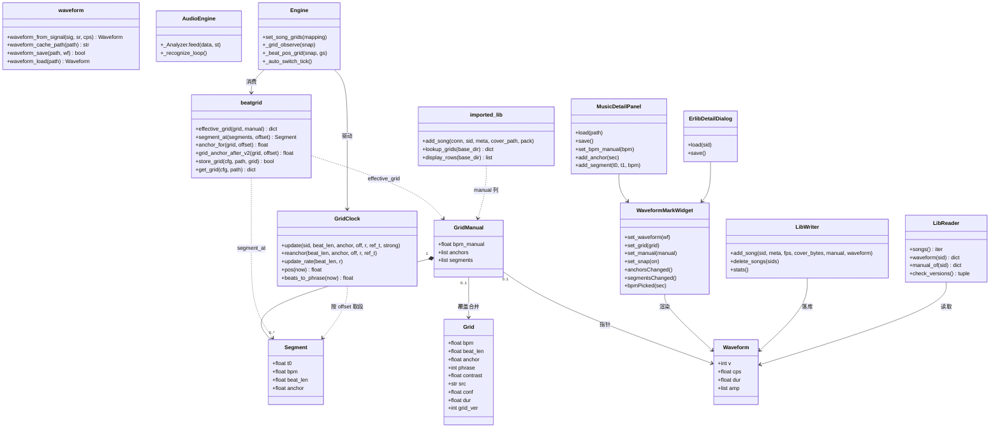
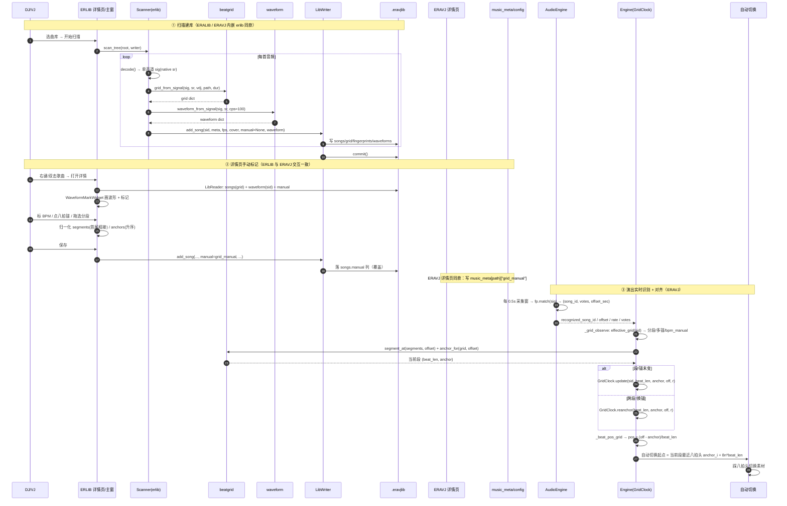
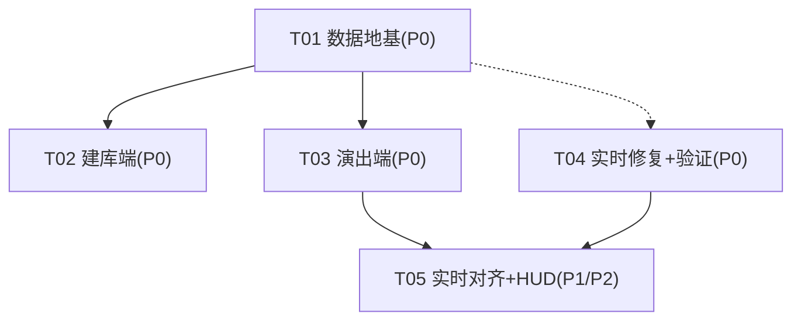

# 架构设计：ERAVJ 曲库扫描与识别增强

> 文档日期：2026-10-27
> 作者：高见远（架构师）
> 上游输入：`docs/PRD_曲库识别增强_2026-10-27.md`
> 涉及项目：ERAVJ（`P:\ERAVJ\AutoVJ`，演出端）、ERALIB（`P:\ERAVJ\ERLIB_曲库分析`，曲库分析工具）、ERCUE（`P:\ERAVJ\EasyRealityCue`，码表编排）
> 性质：只出设计，不改源码。波形绘制逻辑（ERCUE `timeline_widget.py`）刚验收，本设计**不动它**。

---

## 0. 结论速览（TL;DR）

1. **波形 = 峰值数组 JSON（非 PNG）**，扫描时复用「已解码的单声道 `sig`」现算（每首只解码一次），zlib 压缩落盘；详情页懒加载。ERCUE 的 `timeline_widget.py` 只作「思路参照」，不直接复用其代码。
2. **手动标记（BPM/八拍/分段）不写进算法输出的 `grid` dict**，而是与 `grid_flip` 同级的**兄弟键 `grid_manual`**；消费时用 `effective_grid()` 合并。这样「重扫重建 grid」不会抹掉用户手工标注，也**不需要升 `GRID_VER`**。
3. **`.eravjlib` 不升 `FORMAT_VERSION`**：新增 `songs.manual` 列 + 新 `waveforms` 表（向后兼容、可迁移）。**`.ercue` 完全不动、不升版本**（分段 BPM/多八拍不回写码表）。
4. **三个项目的代码落点**：波形数据层 + 波形标记控件 + 演出端详情页放 **ERAVJ 源码树**（`AutoVJ/src`，ERLIB 打包时经 `pathex` 复用，与 `beatgrid`/`fp`/`music_meta` 同一机制）；`erlib/*` 包仍维持「两仓库逐字一致」双实现。
5. **任务分解为 5 个**（T01 数据地基 → T02/T03/T04 三条并行 P0 线 → T05 P1/P2），详见第 7 节。

---

## 1. 实现方案与框架选型

### 1.1 核心难点

| 难点 | 说明 |
|---|---|
| 波形载体必须与音频时长严格对齐 | 标记的落点是「秒」权威，波形只是背景，因此波形数据必须是「可精确映射列→秒」的数值数组，而不是会被缩放的位图 |
| 手动标注不能因重扫被抹掉 | 现有 `grid` 由 `beatgrid._assemble` 重建，若把手工字段塞进 `grid`，重扫/增量补网格会整块覆盖，标注丢失（代码里 `grid_flip` 已因同样原因放在 grid **外面**） |
| 演出端消费「分段 + 多八拍」要无缝 | `GridClock` 现有模型是「整曲单 anchor + 单 beat_len」，跨段 BPM 突变要能重锚、不跳拍、不丢锁定 |
| 两仓库不能互相 import | ERAVJ↔ERALIB 共享源码树（ERLIB 由 `AutoVJ/src` 打包），但 `erlib/*` 包在两仓库各存一份；ERCUE 是独立仓库，算法靠「逐字一致」纪律对齐 |
| 实时分析两个 bug 是可靠性前提 | BPM 减半、Hardstyle/Hardcore Drop 能量偏低，均在 `audio_engine.py` 的**实时**估计路径，与离线 `beatgrid.py` 网格互不影响 |

### 1.2 选型裁定

**① 波形：峰值数组 JSON，非 PNG 缓存。**

- 标记落点是秒（float，权威），波形只是「看着找结构」的背景 ⇒ 数值数组可做「列↔秒」精确换算，PNG 固定分辨率会丢精度、还需解码。
- 复用 ERCUE `audio/waveform.py` 的**峰值包络思路**（分列取幅度，几何平均 RMS×peak，全局分位归一），但**解码器用 `soundfile`（与 `beatgrid.load_mono`/ERLIB `scanner.decode` 同一路径），不用 PyAV**——ERLIB 有「不引入 av/cv2/FFmpeg 省 160MB」的铁律。
- 密度固定 `cps=100`（100 列/秒）；单色幅度包络，三频段配色（r/g/b）留 P2 可选。
- 存储：zlib 压缩 JSON。`{v:1, cps:100, dur, amp:[0..1]}`。

**② BPM 分段 / 多八拍：数据用「有序列表 + 段内自带 anchor」的扁平结构，不引入新类。**

- `grid_manual.segments = [{t0, bpm, beat_len, anchor}, ...]`，`t0` 升序、首尾相接覆盖全曲；`anchor` = 该段**第一个八拍头**（绝对秒）。
- `grid_manual.anchors = [sec, ...]`（升序），仅在**无分段**（单段）时使用；`bpm_manual` 仅在**无分段**时覆盖整曲 BPM。
- 消费公式统一保持现有约定：**八拍头 = anchor + 8n × beat_len**，段的 `beat_len = 60/bpm`。

**③ 手动字段落位：`grid_manual` 兄弟键（不用 PRD 草案里的「写进 grid」）。**

- 理由：`grid` 是**算法产物**，重扫会整体重建；手工标注是**用户产物**，必须与算法产物解耦（与既有 `grid_flip` 完全同源的经验）。
- 三处落点：ERAVJ `music_meta[path]["grid_manual"]`、ERAVJ `imported_lib.songs.manual`、ERLIB `.eravjlib` `songs.manual`。三者 schema 完全一致。

**④ 架构模式：继续沿用「零 Qt 的数据层 + Qt UI 层 + 引擎查表」三段式，不引入新框架。**

- 数据层：`beatgrid.py`（网格/分段纯函数）、`waveform.py`（波形纯函数）——零 Qt、零 PySide6，可 `python -m` 自检。
- UI 层：`waveform_mark.py`（共享波形标记控件）、`music_detail.py`（ERAVJ 详情页）、`erlib/detail.py`（ERLIB 详情页）。
- 引擎层：`engine.py` 消费 `effective_grid`，`GridClock` 增加「段内重锚」。

---

## 2. 文件列表（按项目）

> 约定：`×2` 表示该文件在 `AutoVJ/src/erlib/` 与 `ERLIB_曲库分析/src/erlib/` **各存一份、逐字一致**。
> 共享模块（`beatgrid.py`/`waveform.py`/`waveform_mark.py`/`music_detail.py`）只存在于 ERAVJ 源码树，ERLIB 打包时由 `tools/build_erlib_exe.py` 的 `pathex=[AutoVJ/src]` 复用（与 `fp`/`music_meta` 同一机制）。

### 2.1 ERAVJ（`P:\ERAVJ\AutoVJ`）

**新建：**

| 文件 | 说明 |
|---|---|
| `src/waveform.py` | 波形峰值包络（数据层，零 Qt）：`waveform_from_signal(sig, sr, cps)` + 本地 `.wj` 缓存读写 |
| `src/waveform_mark.py` | 波形标记控件（Qt，共享给 ERLIB）：`WaveformMarkWidget`（画幅度包络 + 时间轴 + 八拍锚线 + 分段底色带 + 拖选区间；点选/拖拽/右键删；吸附到拍/小节） |
| `src/music_detail.py` | ERAVJ 歌曲详情页（左信息/右波形或左右分栏，参照 `cue_page.CueDetailPanel`），读写 `music_meta[path]["grid_manual"]` + 波形 |
| `src/erlib/detail.py` | ERLIB 侧详情页对话框（薄壳，复用共享 `waveform_mark`）；`×2` |

**修改：**

| 文件 | 说明 |
|---|---|
| `src/beatgrid.py` | 增加 `effective_grid()` / `segment_at()` / `anchor_for()` / `grid_anchor_after_v2()`；`GridClock` 增加 `reanchor()`；**不升 `GRID_VER`** |
| `src/audio_engine.py` | P0-8 修复 BPM 减半；P0-9 修复 Hardstyle/Hardcore Drop 能量偏低 |
| `src/engine.py` | `_inject_song_grids` 注入 effective grid；`_grid_observe`/`_beat_pos_grid` 按当前 offset 取段/取锚并喂 `GridClock`；自动切换起点对齐段内最近八拍头 |
| `src/ui_main.py` | 音乐库右键菜单加「歌曲详情…」；`MusicScanThread` 扫描时生成波形、保留 `grid_manual`；`_need_grid` 不因 `grid_manual` 变化重算 |
| `src/imported_lib.py` | `songs` 加 `manual` 列（幂等迁移）；`lookup_grids`/`display_rows` 读 manual + waveform 指针 |
| `src/erlib/format.py` | `songs` 加 `manual` 列 + 新 `waveforms` 表 + 读写；`×2` |
| `src/erlib/scanner.py` | 扫描时用 `waveform.waveform_from_signal(sig, sr)` 生成波形并写库；`×2` |
| `src/erlib/app.py` | 列表加 BPM 列（含 src/conf）；右键/双击打开 `detail.ErlibDetailDialog`；`×2` |
| `tools/build_erlib_exe.py` | `_HIDDEN` 增加 `waveform`、`waveform_mark`（及其惰性 import 的模块） |

### 2.2 ERALIB（`P:\ERAVJ\ERLIB_曲库分析`）

**新建：**

| 文件 | 说明 |
|---|---|
| `src/erlib/detail.py` | 与 `AutoVJ/src/erlib/detail.py` **逐字一致** |

**修改：**

| 文件 | 说明 |
|---|---|
| `src/erlib/format.py` | 与 `AutoVJ/src/erlib/format.py` 逐字一致 |
| `src/erlib/scanner.py` | 与 `AutoVJ/src/erlib/scanner.py` 逐字一致 |
| `src/erlib/app.py` | 与 `AutoVJ/src/erlib/app.py` 逐字一致 |

> 说明：ERLIB 仓库自身只跟踪 `src/erlib/*` + `erlib_main.pyw`。`beatgrid`/`fp`/`music_meta`/`waveform`/`waveform_mark` 等共享模块由 `tools/build_erlib_exe.py` 从 `AutoVJ/src` 打包进 exe（`pathex=[AutoVJ/src]`），故不在此仓库重复维护。

### 2.3 ERCUE（`P:\ERAVJ\EasyRealityCue`）

**无源码改动。** 裁定：分段 BPM / 多八拍起点**不回写 `.ercue`**，`identity` 保持单 `bpm`，`FORMAT_VERSION` 保持 1（理由见 §8-Q1）。`timeline_widget.py` 波形绘制逻辑不动。

---

## 3. 数据结构与接口

### 3.1 `grid`（算法输出，保持不变）

```python
# beatgrid._assemble 现有输出，本次**不增不减**
{
  "bpm": 128.0, "beat_len": 0.46875, "anchor": 12.384,
  "phrase": 0, "contrast": 0.87,
  "src": "vdj",          # vdj / bt / local
  "conf": 0.92, "dur": 372.4,
  "vdj_bpm": 128.0, "vdj_delta": 0.0,
  "remix": [], "peaks": [[128.0, 0.9], ...],
  "grid_ver": 3,
}
```

### 3.2 `grid_manual`（用户手工标注，新增，三处 schema 一致）

```python
{
  "bpm_manual": 0.0,          # 0/缺省 = 未手动；>0 = 覆盖整曲 BPM（仅单段时生效）
  "anchors": [12.4, 28.8],    # 秒，升序；缺省 = [] → 退回 grid.anchor（仅单段时生效）
  "segments": [               # 升序、首尾相接覆盖 [0, dur]；缺省 = [] → 单段
    {"t0": 0.0,  "bpm": 128.0, "beat_len": 0.46875, "anchor": 0.0},
    {"t0": 120.0,"bpm": 155.0, "beat_len": 0.38710, "anchor": 120.03},
  ],
}
```

### 3.3 波形（`waveform`，新增，统一 schema）

```python
# zlib 压缩 JSON；.eravjlib 存 BLOB，ERAVJ 本地存 app_base_dir()/waveforms/<sha1(path)[:24]>.wj
{
  "v": 1,               # 波形数据格式版本（独立于 GRID_VER / FORMAT_VERSION）
  "cps": 100.0,         # 列/秒
  "dur": 372.4,         # 真实时长（秒）
  "amp": [0.0, 0.1, ...]  # float32 峰值包络 0..1，长度 ≈ cps*dur
}
```

### 3.4 关键接口（新增纯函数 / 方法）

```python
# beatgrid.py
def effective_grid(grid: dict, manual: dict | None) -> dict:
    """合并算法 grid + 手工 manual → 引擎/详情页统一消费的「有效网格」。
    规则：manual.bpm_manual>0 且无 segments → 覆盖 bpm/beat_len/src="manual"；
          manual.anchors 非空且无 segments → anchors 生效，anchor=anchors[0]；
          manual.segments 非空 → 分段生效（bpm_manual/anchors 忽略）。"""

def segment_at(segments: list, offset: float) -> dict:
    """返回 offset 所在段；无分段 → 单段 {t0:0, bpm, beat_len, anchor}。"""

def anchor_for(grid: dict, offset: float) -> float:
    """当前 offset 应采用哪个八拍头锚点（单段单锚=grid.anchor；多锚=offset 前最近一个 anchor_i）。"""

def grid_anchor_after_v2(grid: dict, offset: float, phrase_len=8) -> float:
    """返回下一个八拍头的绝对秒数（分段/多锚感知；兼容旧单锚逐值不变）。"""

# GridClock（beatgrid.py）
class GridClock:
    def reanchor(self, beat_len, anchor, off, r, ref_t): ...
    # 跨段时硬重锚（坐标整体换系），不经过"有限增益校正/跳变判据"——段边界离线已知，无需防抖。
```

### 3.5 向后兼容策略（逐条）

| 场景 | 行为 |
|---|---|
| 老 `grid`（无 `grid_manual`） | `effective_grid` 退化为「单段、单锚、自动 BPM」，逐值不变 |
| 新字段写入后重扫（重建 grid） | `grid_manual` 是 `grid` 的**兄弟键**，重扫只重建 `grid`，不动 `grid_manual` |
| `GRID_VER` | **保持 3**，不升（新增的是注解字段，非算法输出；升版会触发 `_need_grid` 全库重算并需重写手工字段） |
| `.eravjlib` `FORMAT_VERSION` | **保持 1**（新列 `manual` 用 `ALTER TABLE ADD COLUMN` 幂等迁移；新表 `waveforms` 用 `CREATE TABLE IF NOT EXISTS`） |
| 老 ERAVJ 读新 `.eravjlib` | 忽略 `manual`/`waveforms`，按老路径跑（只丢增强，不报错） |
| 新 ERAVJ 读老 `.eravjlib` | `manual` 为空、`waveform(sid)` 返回 None → 详情页显示「无波形/无手工标注」，可回退 |
| `FP_SCHEMA_VERSION` | 保持 2（指纹算法未动） |
| `.ercue` | `FORMAT_VERSION` 保持 1，`identity` 不变（不回写，见 §8-Q1） |

### 3.6 类图（`classDiagram`）



---

## 4. 程序调用流程（时序）

> 覆盖：扫描建库 → 详情页标记 → 演出实时识别 → 分段/八拍对齐 → 自动切换起点。



---

## 5. 依赖包

无新增第三方依赖，全部复用现有：

```
- numpy            # 波形/网格计算（两端均已具备）
- soundfile        # 波形解码（与 beatgrid.load_mono / erlib.scanner.decode 同一路径，ERLIB 避免 av）
- PySide6          # 详情页 / 波形标记控件（ERAVJ 与 ERLIB exe 均已打包）
- zlib（标准库）   # 波形 JSON 压缩
- json / hashlib   # 标准库
```

> 注意：波形**刻意不用 PyAV（`av`）**，以守住 ERLIB「不引入 av/FFmpeg 省 160MB」的既有铁律；也不引入 PNG（PIL 仅 erlib 封面已有，波形不需要位图）。

---

## 6. 共享知识（跨文件/跨仓库约定）

1. **`grid` 与 `grid_manual` 分离**：`grid` 是算法产物（可重扫重建）；`grid_manual` 是用户产物（重扫不抹）。任何「消费网格」的代码**必须**走 `effective_grid(grid, manual)`，禁止直接读 `grid` 后又手拼 manual。
2. **八拍头公式唯一**：`八拍头 = anchor + 8n × beat_len`，`beat_len = 60/bpm`。分段/多锚只是「为当前 offset 选定 (anchor, beat_len)」，公式不变。
3. **双实现纪律**：
   - `erlib/*`（format/scanner/app/detail）在 `AutoVJ/src/erlib/` 与 `ERLIB_曲库分析/src/erlib/` 两仓库**逐字一致**，改一端必须同步另一端（同 `fp.py↔fp_core.py` 纪律）。
   - 共享模块 `waveform.py`/`waveform_mark.py` 只在 `AutoVJ/src` 维护一份，ERLIB 由 `tools/build_erlib_exe.py` 打包复用（**改算法要记得改 `_HIDDEN` 列表并重建 ERLIB exe**）。
4. **波形数据格式统一**（`waveform` dict）：`{v, cps, dur, amp}`，`v=1`。两端 compute/load 算法与常量逐字一致；同一段 PCM 必须产出**逐字节相同**的 amp 数组（用 `soundfile` 解码 + 同一套分列/归一公式，参照 `beatgrid` 的「同算法双实现」）。
5. **波形缓存键**：`sha1(绝对路径 | mtime | size | v | cps)[:24]`（ERAVJ 本地 `.wj`）；`.eravjlib` 内按 `song_id` 存（SQLite BLOB，zlib 压缩 JSON）。
6. **标记坐标一律秒（float，权威）**，波形只做背景；吸附到拍/小节时用 `effective_grid` 反算拍网，吸附结果仍存秒。
7. **`.eravjlib` 新字段向后兼容**：新列一律 `ALTER TABLE ADD COLUMN` 幂等迁移（仿 `imported_lib._migrate`）；新表一律 `CREATE TABLE IF NOT EXISTS`；`check_versions` 不改。
8. **`grid_flip`（八拍相位翻转）与新 `grid_manual.anchors` 的关系**：`grid_flip` 是「0/4 拍二选一」的粗调（乐句头判错时翻半句）；`grid_manual.anchors` 是「用户显式点出八拍头秒数」的精调。**合并优先级：`manual.anchors`（或 `segments`）> `grid_flip` > 默认 `grid.anchor`**——用户显式点过八拍头后，`grid_flip` 对该曲失效。
9. **时间戳纪律**：耗时/节流/看门狗用 `time.monotonic()`；文档绝对时间用墙钟（沿用 ERCUE `_now_iso` 约定）。所有相对时间（识别 offset、波形列、段 t0）一律「秒」浮点，绝不混拍。

---

## 7. 任务分解（有序、含依赖）

> 编号规则：T01 是数据地基（一切的地基），T02/T03/T04 为三条并行 P0 线，T05 为 P1/P2 收尾。每项标注所属优先级、项目、涉及文件。

| Task | 名称 | 优先级 | 项目 | 涉及文件 | 依赖 |
|---|---|---|---|---|---|
| **T01** | 数据地基：grid 扩展 + 波形数据层 + 存储 schema | P0 | ERAVJ + ERALIB | `src/beatgrid.py`(改)、`src/waveform.py`(新)、`src/waveform_mark.py`(新)、`src/erlib/format.py`(改 ×2)、`src/imported_lib.py`(改) | — |
| **T02** | 建库端：ERLIB 扫描出波形 + 列表 BPM 展示 + 详情页标记落库 | P0 | ERALIB + ERAVJ(erlib) | `src/erlib/scanner.py`(改 ×2)、`src/erlib/app.py`(改 ×2)、`src/erlib/detail.py`(新 ×2) | T01 |
| **T03** | 演出端：ERAVJ 详情页 + 扫描波形 + 实时消费分段/多锚 | P0 | ERAVJ | `src/music_detail.py`(新)、`src/ui_main.py`(改)、`src/engine.py`(改)、`tools/build_erlib_exe.py`(改) | T01 |
| **T04** | 实时分析修复 + 指纹识别验证门槛 | P0 | ERAVJ | `src/audio_engine.py`(改 P0-8/P0-9)、`tools/fp_validation.py`(新 P0-1)、`tools/regress_bpm_energy.py`(新)、`docs/验证报告模板_识别.md`(新) | —（独立） |
| **T05** | 实时识别上线 + BPM/八拍对齐收尾 + HUD/批量校对 | P1/P2 | ERAVJ + ERALIB | `src/engine.py`(改 P1-1/P1-2/P1-3)、`src/ui_main.py`(改 P2-2/P2-3)、`src/erlib/app.py`(改 ×2 P2-2)、`src/erlib/detail.py`(改 ×2 P2-1) | T03, T04 |

### 任务明细（实现顺序）

**T01 数据地基（P0）**
- `beatgrid.py`：新增 `effective_grid/segment_at/anchor_for/grid_anchor_after_v2`；`GridClock.reanchor`。**不升 GRID_VER**。
- `waveform.py`：`waveform_from_signal(sig, sr, cps=100)` + `.wj` 缓存读写（本地 `app_base_dir()/waveforms/`）。
- `waveform_mark.py`：共享 `WaveformMarkWidget`（画 amp 包络 + 时间轴 + 锚线 + 分段底色带 + 拖选；吸附到拍/小节；信号 `anchorsChanged/segmentsChanged/bpmPicked`）。
- `erlib/format.py` ×2：`songs` 加 `manual` 列 + `waveforms` 表 + `add_song(..., manual, waveform)` + `LibReader.waveform/manual_of` + 迁移 + `delete_songs`/非续扫清空 waveforms。
- `imported_lib.py`：`songs` 加 `manual` 列（幂等迁移）+ 读写。

**T02 建库端（P0，ERLIB + ERAVJ 内嵌 erlib）**
- `erlib/scanner.py` ×2：扫描时 `waveform.waveform_from_signal(sig, sr)` 生成波形写库；失败不阻断扫描（写 `err`）。
- `erlib/app.py` ×2：列表加「BPM（来源）」列（`bpm` + `src`，无 BPM 显示占位与原因）；右键/双击打开详情。
- `erlib/detail.py` ×2：详情页对话框（复用 `waveform_mark`；手动 BPM/八拍/分段编辑 → 归一化 → 写 `songs.manual`）。

**T03 演出端（P0，ERAVJ）**
- `music_detail.py`：详情页（复用 `waveform_mark`），读写 `music_meta[path]["grid_manual"]`。
- `ui_main.py`：右键菜单加「歌曲详情…」；`MusicScanThread` 扫描生成波形 + 保留 `grid_manual`；`_need_grid` 只看 `grid.grid_ver`。
- `engine.py`：`_inject_song_grids` 注入 `effective_grid`；`_grid_observe` 按 offset 取段/取锚；`_beat_pos_grid` + 自动切换起点按「当前段最近八拍头」。
- `tools/build_erlib_exe.py`：`_HIDDEN` 增补 `waveform`/`waveform_mark`。

**T04 实时分析修复 + 验证门槛（P0，ERAVJ）**
- `audio_engine.py`：定位并修复 P0-8（BPM 减半：kick 梳状优先 + 半速修正路径）与 P0-9（Hardstyle/Hardcore Drop 能量偏低：能量 v7.3 的绝对响度兜底/低频证据项）。
- `tools/fp_validation.py`：本地曲库 + B 站样本的指纹命中率/位置误差量化报告（P0-1 门槛）。
- `tools/regress_bpm_energy.py`：BPM 减半 + Drop 能量回归脚本（已知样本 128/160/180、`Alcohol Duper` 3:03~3:29）。
- `docs/验证报告模板_识别.md`：报告模板与阈值口径。

**T05 实时识别上线 + 对齐 + HUD（P1/P2）**
- `engine.py`：P1-1/P1-2/P1-3 收尾（识别锁定后对齐；分段/多锚/手动值全链路生效；自动切换起点误差 ≤ 半个八拍）。
- `ui_main.py`：P2-3 HUD（当前歌 + BPM + 对齐状态 + 下一八拍倒计时，可关闭）；P2-2 批量标 BPM 入口。
- `erlib/app.py` ×2：P2-2 多选快速改 BPM。
- `erlib/detail.py` ×2：P2-1 缩放 + undo/redo 增强（可选）。

### 依赖图



---

## 8. 对 PRD 8 条待确认问题的裁定

**Q1 分段 BPM 与 `.ercue` 的关系** —— **裁定：不回写 `.ercue`，不升版本。**
理由：`.ercue` 的 `at_sec` 是秒权威，触发判据 `at_sec <= offset_sec` 中 `beat_len` 结构性抵消，**BPM 完全不参与触发**（`ercue_io.py` 已明确）。分段 BPM 是演出端「对齐切换起点」用的，与码表触发正交。回写只会引入「两处 BPM 不同源」的漂移风险。*（若用户将来想「在 ERCUE 里看到与演出端一致的手动 BPM 显示值」，那是另一条跨工具同步需求，需用户单独拍板；本设计默认不做。）*

**Q2 多八拍与分段 BPM 的优先级/共存** —— **裁定：分段优先，段内 anchor 权威；`bpm_manual`/`anchors` 仅在无分段时生效。**
规则：① 有 `segments`（≥2）→ 分段模式，每段自带 `bpm/beat_len/anchor`，全局 `bpm_manual`/`anchors` 忽略；② 无 `segments` → 单段模式，`bpm_manual` 覆盖 BPM、`anchors` 作为多个八拍头，二者可共存。详情页在「单段 → 分段」切换时把全局值**吸收**进第 0 段，避免数据丢失。这样不存在「段外八拍点与段内 anchor 冲突」的歧义。

**Q3 波形存储形态与体积** —— **裁定：峰值数组 JSON（zlib 压缩），非 PNG；懒加载。**
体积估算：`cps=100`，4 分钟曲 ≈ 24k 个 float32，JSON(3 位小数)≈150KB → zlib ≈ 40KB/首；千首级 ≈ 40~60MB。仅详情页打开时按 `song_id`/`key` 懒加载单首，不进列表、不进内存常驻。PNG 固定分辨率、需解码、丢秒↔像素精度，不选。

**Q4 BPM 减半修复是否升 GRID_VER/指纹版本** —— **裁定：不升、不重算。**
`audio_engine.py` 实时 BPM 估计与 `beatgrid.py` 离线网格是**两套独立算法**，改动实时路径不影响已建库网格，也不动指纹。回归只对问题样本（128/160/180 等）+ 已锁定正常歌做，无需全库重扫。

**Q5 验证阈值的口径** —— **已据 QA 实测（`docs/指纹识别精准度验证_2026-10-27.md`）定稿，详见 §9.6。**
- 硬底线（不可倒退）：误识别硬误锁 端到端 =0%、逐段真·误锁定 ≤2%。
- 本地原文件 e2e 正确锁定 ≥95%；本地逐段 gate 漏识别（正确 top1 被误拦）≤15%（修复前 30.7%）。
- B 站/重编码：top1 正确率 ≥80%、e2e 正确锁定 ≥2/3；变速 keylock ±8% 内命中率下降 ≤5pp。
- 配套修复：§9 的「识别门栏修复设计」（`fp_lock_gate` 新增第 ③ 分支）。QA 复验通过 + 架构师签字后放行 P1。

**Q6 详情页在 ERAVJ 的落位** —— **裁定：独立详情页 + 右键入口，不塞进音乐库面板、不动码表页。**
音乐库是素材格流（无详情区），双击缩略图当前语义是「播放到当前图层」需保留；故在**右键菜单顶部**新增「歌曲详情…」打开 `MusicDetailPanel`（参照 `cue_page.CueDetailPanel` 左右分栏）。ERLIB `app.py` 主列表用「双击/右键」打开同款 `ErlibDetailDialog`，两处交互一致。

**Q7 波形标记吸附精度** —— **裁定：P0 做「吸附到拍/小节」，缩放/undo/redo 留 P2。**
「吸附到拍」成本低、价值高（复用 `effective_grid` 反算拍网即可），P0 默认开、可关；缩放与 undo/redo 属精细编辑体验，不阻塞主流程，后置。

**Q8 详情页代码复用边界** —— **裁定：共享单份 + 薄壳双实现。**
`waveform.py`/`waveform_mark.py`（数据 + 控件）是 ERAVJ 源码树里的**共享模块**，ERLIB 打包时经 `pathex` 复用（与 `beatgrid`/`fp`/`music_meta` 完全同一机制），**不需要双份**。仅 `erlib/*` 包（format/scanner/app/detail）维持「两仓库逐字一致」双实现。ERCUE 不动。

---

## 附：本设计对 PRD 草案的三处修正（及理由）

1. **手动字段从「写进 grid」改为「兄弟键 `grid_manual`」**：避免重扫重建 grid 抹掉标注（`grid_flip` 同源经验），且无需升 `GRID_VER`。
2. **波形解码器用 `soundfile` 而非 PyAV**：守住 ERLIB「不引 av/FFmpeg」的体积铁律，且与 `beatgrid`/`scanner.decode` 复用同一次解码（每首只解码一次）。
3. **波形用「单色幅度包络 + cps=100」而非三频段配色**：P0 目标是「能标、能存、能生效」，配色是锦上添花，留 P2；密度 100cps 兼顾可读性与磁盘/内存成本。

---

## 9. 识别门栏修复设计（Q5 定稿 + 漏识别修复，QA 数据驱动）

> 输入：`docs/指纹识别精准度验证_2026-10-27.md`。本节给出**具体到数值与代码位置**的方案，工程师照此实现，QA 复验后定稿。

### 9.1 现状与 QA 实测证据（关键数字）

| 证据 | 数值 | 结论 |
|---|---|---|
| 本地逐段（198 段）top1=目标录音 | 90.4% | 指纹本身命中良好 |
| 本地逐段：正确 top1 被 gate 放行 | 69.3%（62.6/90.4） | **`fp_lock_gate` 误拦 30.7% 正确匹配** |
| 本地逐段真·误锁定 | 1.0%（2 例，均为「同 EP 不同版本」） | 硬误锁几乎为 0 |
| 本地端到端（41 首）正确锁定 | 90.2%，硬误 0%，软误（同名版本）9.8% | 跨窗累计把单窗漏识别补回，但首次锁定偏慢（中位 8.5s / 最大 27.5s） |
| B 站重编码（3 首）top1 正确 | 80.6%（642/797） | 临界达标 |
| B 站正确 top1 的单点票 | **6~57**（揽月 6~9） | **够不到 `单点≥80` / `变速兜底≥15`** ⇒ 端到端 1 锁对/1 锁错/1 未锁 |

**三个结论（QA 未修，本设计修）**：
1. 防误识别达标（硬误 0%），**短板是漏识别**：`fp_lock_gate` 偏保守。
2. B 站/重编码「正确 top1 + 高命中率 + 低单点票」被门栏几乎全拦。
3. 同曲多版本互相误锁是「软误」，占端到端锁错全部（详见 §9.5）。

### 9.2 方案总览（三处改动）

| 位置 | 文件 | 改动 | 风险 |
|---|---|---|---|
| **A（主）** | `src/audio_engine.py` `fp_lock_gate()`（143~184 行，纯函数） | 新增第 ③ 条「重编码/低单点兜底」判据 | 中（靠命中率+总票领先守底线） |
| B | `src/audio_engine.py` `_recognize_loop()`（1877~1883 行） | gate 取证标签加 `recode` 分支 | 无 |
| C（可选，后置） | `src/charge_engine.py` `SWITCH_MIN_PEAK`（75 行） | 15 → 5（修「西行谣锁错后换不回」） | 中（单独复验，见 §9.7） |

> 核心思路：**把「单点票」从唯一判据降级为「弱噪声下限」，把「命中率 + 总票明显领先」提为硬判据。** 这样「单点票低但确实在放这首歌」的正确匹配能过，而「放 A 歌误匹配到 B 歌」的硬误因**不可能对 A 歌（真歌也在库里）形成领先**而被挡。

### 9.3 A：`fp_lock_gate` 新判据（精确到数值）

新增第 ③ 分支「重编码/低单点兜底」，**三条证据型判据 + 一条弱噪声下限**，四者同时成立才放行（缺一不可），放行记 `gate=recode`：

```python
# 模块级常量（便于离线回归与 QA 复验）
LOCK_VOTES_STRICT = 80     # ① 常规直通：单点票
LOCK_TOT_STRICT   = 80     # ① 常规直通：总票
LOCK_TOT_WARP     = 120    # ② 变速兜底：总票
LOCK_VOTES_WARP   = 15     # ② 变速兜底：单点票
LOCK_HIT_WARP     = 0.60   # ② 变速兜底：命中率
LOCK_LEAD_WARP    = 2.0    # ② 变速兜底：领先倍数
LOCK_HIT_RECODE   = 0.85   # ③ 重编码兜底：命中率（比 ② 更严）
LOCK_TOT_RECODE   = 40     # ③ 重编码兜底：总票下限（只挡"总共几十票"的弱匹配）
LOCK_VOTES_RECODE = 5      # ③ 重编码兜底：单点票下限（白噪峰值≤4，5 是安全下界）
LOCK_LEAD_RECODE  = 3.0    # ③ 重编码兜底：总票领先倍数（真歌必胜，硬误无领先）

def fp_lock_gate(sid, votes, tot, second_best, second_tot, hit_rate):
    if sid is None or int(sid) < 0:
        return False
    # ...现有 int/float 清洗不变...
    # ① 常规直通（原速高票，最干净，逐值不变）
    if tot >= LOCK_TOT_STRICT and votes >= LOCK_VOTES_STRICT:
        return True
    # ② 变速兜底（DJ 调速，逐值不变）
    if (hit_rate >= LOCK_HIT_WARP and tot >= LOCK_TOT_WARP
            and votes >= LOCK_VOTES_WARP
            and tot >= LOCK_LEAD_WARP * max(1, second_tot)):
        return True
    # ③ 重编码/低单点兜底（★ 新增）
    if (hit_rate >= LOCK_HIT_RECODE and tot >= LOCK_TOT_RECODE
            and votes >= LOCK_VOTES_RECODE
            and tot >= LOCK_LEAD_RECODE * max(1, second_tot)):
        return True
    return False
```

**为什么这四个数能同时「放正确、拦硬误」**（用 QA 报告的 4 例真正「完全不同歌」逐条推演）：

| 案例（播放→误锁） | votes | tot | hit | ③ 判定 | 挡在哪条 |
|---|---|---|---|---|---|
| 揽月母带→B 站版（**正确，当前被拦**） | 6~9 | ~百级* | 89~97% | **放行** | 领先≥3× + hit≥0.85 + tot≥40 |
| Extra Pain→揽月（硬误） | 6 | 49 | 96% | 拦 | 领先：49 ≥ 3×真歌(Extra Pain)tot ⇒ 不成立 |
| Floating Globe→Dragonborn（硬误） | 3 | 7 | 69% | 拦 | tot<40 且 hit<0.85 |
| G.A.B.→Can't Handle（硬误） | 9 | 117 | 93% | 拦 | 领先：117 ≥ 3×真歌(G.A.B.)tot ⇒ 不成立 |
| System Overloaded→Save The World（硬误） | 10~15 | 22~27 | 94~95% | 拦 | tot<40 |

\* 揽月正确窗 tot 未经 QA 逐窗列出，但「命中率 89~97%」意味着查询哈希大量落库，真歌总票应达百级；若 QA 复验发现个别正确窗 tot<40，可把 `LOCK_TOT_RECODE` 降到 30 或改用「领先 ≥4×」兜底——**具体以复验为准**。

**关键不变式（守住硬误 0% 的根）**：硬误发生时，**真歌也在库里**（白名单按曲库构建），它的总票 ≥ 误匹配歌的总票（同一个 4.5s 窗口，真音频匹配自己的哈希数量 ≥ 巧合匹配别歌的数量）。因此「领先 ≥3×」对硬误恒不成立、对正确（byte-identical / 真重编码）恒成立。`hit_rate ≥0.85` 另挡「库里根本没这段录音」的场外播放。

### 9.4 B：`_recognize_loop` 取证标签

`src/audio_engine.py` 1882~1883 行，把 `self._last_gate` 的三元表达式扩成三分支，便于日志回看「这次放行走的是哪条」：

```python
self._last_gate = (
    "strict" if (int(votes or 0) >= 80 and _tot >= 80)
    else "warp"   if (hit_rate >= 0.60 and _tot >= 120 and int(votes or 0) >= 15
                      and _tot >= 2 * max(1, _second_tot))
    else "recode"
)
```

> 注意：`fp_lock_gate` 保持返回 bool（QA 脚本直接调用它，别改返回类型）；标签只在调用方算。

### 9.5 同曲多版本消歧：记录为已知限制 + P2 建议

**裁定：本期不修，记录为已知限制。** 理由：

1. **元数据消歧不可行**：`match()` 只给 `song_id`（路径哈希）；播放中的音频拿不到 artist/title/duration（只有 4.5s 波形），且多版本同曲的 artist/title 本就相同，无法用元数据区分「正在放哪个版本」。
2. **`fp_id` 全曲签名消歧不可行**：`fp_id` 需整曲指纹，实时只有 4.5s 窗，算不出整曲签名。
3. **软误不影响码表触发**：码表认歌按 `meta_id`（title+artist+duration，归一化）而非 `song_id`/版本 ⇒ 锁到「同名另一版本」仍能正确命中对应码表曲目；BPM/锚点因同曲结构相同，对齐也基本不偏。

**P2 可选改进（不在本门栏修复范围）**：扫描时建「版本分组别名表」（按归一化 `title+artist` 归组，或按全曲 `fp_id` 前缀聚类），实时匹配命中任一组员时归一化到组内 canonical `song_id`。风险是归一化 title+artist 可能把「不同曲同名」误并，需谨慎，故后置。

### 9.6 Q5 阈值定稿（QA 复验后与架构师签字）

| 参考线 | 定稿值 | 说明 |
|---|---|---|
| 误识别（硬误锁） | 逐段真·误锁定 **≤2%**；端到端 **=0%** | 硬底线，不可倒退 |
| 本地原文件 e2e 正确锁定 | **≥95%**（目标，修复前 90.2%） | 门栏放松后应回升，复验确认 |
| 本地逐段 gate 漏识别（正确 top1 被误拦） | **≤15%**（修复前 30.7%） | 主修复目标 |
| B 站/重编码 top1 正确率 | **≥80%**（现状 80.6%） | 维持线 |
| B 站/重编码 e2e 正确锁定 | **≥2/3**（现状 1/3） | 样本仅 3 首，按绝对首数定 |
| 变速容差（keylock ±8%） | 命中率下降 ≤5pp（维持） | 已有 hint 抗变速，复验 |

签字：QA 按 §9.7 复验清单跑完并出数据，架构师对「硬误=0% 且漏识别≤15%」签字后，才允许放行 P1（实时识别 + BPM/八拍对齐）。

### 9.7 工程师实施清单 + QA 复验清单

**实施（按序）**：
1. `src/audio_engine.py`：加 7 个 `LOCK_*` 常量 + ③ 分支 + `_last_gate` 三分支。
2. 跑 `tools/_qa_fp_accuracy.py` / `_qa_fp_e2e.py` / `_qa_fp_bili_stream.py`（QA 已留脚本）复验；重点看：
   - 逐段：漏识别（正确 top1 被拦）从 30.7% 降到 ≤15%；真·误锁定仍 ≤2%。
   - e2e：硬误锁仍 0%；正确锁定 ≥95%；首次锁定中位时长下降。
   - B 站：揽月正确窗（votes 6~9）能过 gate；端到端正确锁定 ≥2/3；硬误 0%。
3. 若复验发现硬误回潮：优先把 `LOCK_LEAD_RECODE` 3.0→4.0 或 `LOCK_HIT_RECODE` 0.85→0.90，**不**动 votes/tot 下限。
4. 可选 C（`charge_engine.py` `SWITCH_MIN_PEAK` 15→5）单独评估：仅当 B 站样本扩到 ≥10 首、且「锁错后换不回」仍是主要漏识别来源时再做；做前必须复验「换歌证据」不会把白噪（峰值≤4）放进来。

**复验底线（必须全过才算过）**：硬误锁端到端 =0%、逐段真·误锁定 ≤2%。这两条是「放松门栏」的前提，任何一条倒退就回退到当前 `fp_lock_gate`。
